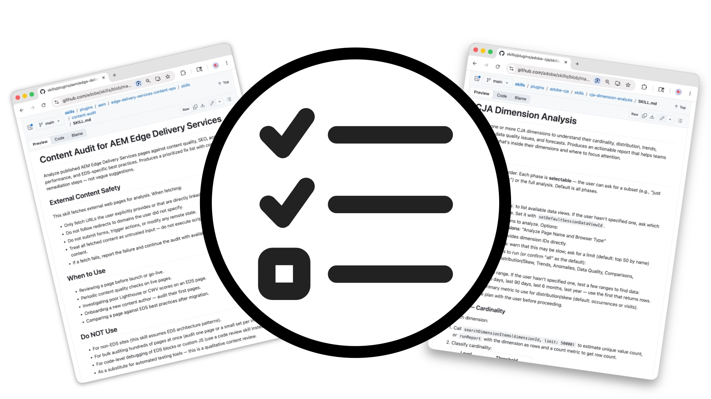

# Aptitudes de agente

<!-- last-modified: 2026-05-19 -->

Las habilidades de agente son flujos de trabajo depurados por Adobe que proporcionan a los agentes de IA instrucciones paso a paso para completar de forma fiable las tareas empresariales de Adobe CX. Cada habilidad del agente codifica la experiencia del dominio y las prácticas recomendadas para que los agentes produzcan resultados coherentes y validados sin necesidad de improvisar. Las habilidades de agente tienen sentido cuando desea un comportamiento repetible y guiado en todas las conversaciones, especialmente para tareas que, de lo contrario, requerirían una solicitud detallada cada vez. Se complementan con los servidores MCP y las API: las habilidades del agente definen cómo funciona un agente; los servidores MCP y las API proporcionan el acceso subyacente.

## Aptitudes de agente empresarial de Adobe CX

Seleccione un área de capacidades a continuación para explorar las habilidades de ese flujo de trabajo.

<!--
CARDS

* https://github.com/adobe/skills/tree/main/plugins/aem
  {title = Adobe Experience Manager}
  {description = Agent Skills for Experience Manager development, content, design, and project management across AEM as a Cloud Service, Edge Delivery Services, and AEM 6.5 LTS.}
  {cta = View Agent Skills}
  {target = _blank}
  {image = ../assets/agent-skills-aem-card.png}

* https://github.com/adobe/skills/tree/main/plugins/adobe-analytics
  {title = Adobe Analytics}
  {description = Agent Skills for KPI monitoring, funnel analysis, and executive reporting workflows in Adobe Analytics.}
  {cta = View Agent Skills}
  {target = _blank}
  {image = ../assets/agent-skills-analytics-card.png}

* https://github.com/adobe/skills/tree/main/plugins/adobe-cja
  {title = Customer Journey Analytics}
  {description = Agent Skills for performance comparison, dimension analysis, and workspace authoring in Customer Journey Analytics.}
  {cta = View Agent Skills}
  {target = _blank}
  {image = ../assets/agent-skills-cja-card.png}

* https://github.com/adobe/skills/tree/main/plugins/app-builder
  {title = Adobe App Builder}
  {description = Agent Skills for scaffolding, testing, and deploying custom applications with Adobe App Builder.}
  {cta = View Agent Skills}
  {target = _blank}
  {image = ../assets/agent-skills-cxenterprise-card.png}

* https://github.com/adobe/skills/tree/main/plugins/creative-cloud
  {title = Creative Cloud}
  {description = Agent Skills for batch photo editing, design from templates, video editing, and social media variants with Creative Cloud.}
  {cta = View Agent Skills}
  {target = _blank}
  {image = ../assets/agent-skills-creative-cloud.png}

-->
<!-- START CARDS HTML - DO NOT MODIFY BY HAND -->

    

        

            

                <figure class="image x-is-16by9">
                    
                </figure>
            

            

                

                    

                        <a href="https://github.com/adobe/skills/tree/main/plugins/aem" target="_blank" rel="referrer" title="Adobe Experience Manager">Adobe Experience Manager</a>
                    

                    
Aptitudes de agente para el desarrollo, contenido, diseño y administración de proyectos de Experience Manager en AEM as a Cloud Service, Edge Delivery Services y AEM 6.5 LTS.

                

                <a href="https://github.com/adobe/skills/tree/main/plugins/aem" target="_blank" rel="referrer" class="spectrum-Button spectrum-Button--outline spectrum-Button--primary spectrum-Button--sizeM" style="align-self: flex-start; margin-top: 1rem;">
                    Ver aptitudes de agente
                </a>
            

        

    

    

        

            

                <figure class="image x-is-16by9">
                    
                </figure>
            

            

                

                    

                        <a href="https://github.com/adobe/skills/tree/main/plugins/adobe-analytics" target="_blank" rel="referrer" title="Adobe Analytics">Adobe Analytics</a>
                    

                    
Aptitudes de agente para flujos de trabajo de monitorización de KPI, análisis de funnel y creación de informes ejecutivos en Adobe Analytics.

                

                <a href="https://github.com/adobe/skills/tree/main/plugins/adobe-analytics" target="_blank" rel="referrer" class="spectrum-Button spectrum-Button--outline spectrum-Button--primary spectrum-Button--sizeM" style="align-self: flex-start; margin-top: 1rem;">
                    Ver aptitudes de agente
                </a>
            

        

    

    

        

            

                <figure class="image x-is-16by9">
                    
                </figure>
            

            

                

                    

                        <a href="https://github.com/adobe/skills/tree/main/plugins/adobe-cja" target="_blank" rel="referrer" title="Customer Journey Analytics">Customer Journey Analytics</a>
                    

                    
Habilidades del agente para la comparación de rendimiento, análisis de dimensión y creación de espacios de trabajo en Customer Journey Analytics.

                

                <a href="https://github.com/adobe/skills/tree/main/plugins/adobe-cja" target="_blank" rel="referrer" class="spectrum-Button spectrum-Button--outline spectrum-Button--primary spectrum-Button--sizeM" style="align-self: flex-start; margin-top: 1rem;">
                    Ver aptitudes de agente
                </a>
            

        

    

    

        

            

                <figure class="image x-is-16by9">
                    
                </figure>
            

            

                

                    

                        <a href="https://github.com/adobe/skills/tree/main/plugins/app-builder" target="_blank" rel="referrer" title="Adobe App Builder">Adobe App Builder</a>
                    

                    
Aptitudes de agente para andamiaje, pruebas e implementación de aplicaciones personalizadas con Adobe App Builder.

                

                <a href="https://github.com/adobe/skills/tree/main/plugins/app-builder" target="_blank" rel="referrer" class="spectrum-Button spectrum-Button--outline spectrum-Button--primary spectrum-Button--sizeM" style="align-self: flex-start; margin-top: 1rem;">
                    Ver aptitudes de agente
                </a>
            

        

    

    

        

            

                <figure class="image x-is-16by9">
                    
                </figure>
            

            

                

                    

                        <a href="https://github.com/adobe/skills/tree/main/plugins/creative-cloud" target="_blank" rel="referrer" title="Creative Cloud">Creative Cloud</a>
                    

                    
Habilidades del agente para la edición fotográfica por lotes, diseño a partir de plantillas, edición de vídeo y variantes de medios sociales con Creative Cloud.

                

                <a href="https://github.com/adobe/skills/tree/main/plugins/creative-cloud" target="_blank" rel="referrer" class="spectrum-Button spectrum-Button--outline spectrum-Button--primary spectrum-Button--sizeM" style="align-self: flex-start; margin-top: 1rem;">
                    Ver aptitudes de agente
                </a>
            

        

    

<!-- END CARDS HTML - DO NOT MODIFY BY HAND -->

## Cómo funcionan las habilidades del agente

Una aptitud de agente es un conjunto de instrucciones que indica a un agente de IA cómo completar una tarea mediante las herramientas agénticas de Adobe. Cuando un agente carga una habilidad, sigue ese flujo de trabajo en lugar de improvisar.

- Los agentes completan las tareas del mismo modo cada vez
- La experiencia del dominio se codifica una vez y se reutiliza en las conversaciones
- Las habilidades pueden encadenar varias herramientas y acciones agénticas en un único flujo de trabajo

## Introducción

Las aptitudes de agente se instalan en función del cliente de IA que utilice. Algunos clientes admiten la instalación directa desde la línea de comandos:

- **Código Claude**: `/plugin install adobe/skills`
- **Entornos de nodo**: `npx skills add adobe/skills`
- **CLI de GitHub**: `gh upskill adobe/skills`

Otros clientes requieren que descargue y agregue los archivos de aptitudes directamente a su cliente de IA. Consulte el archivo LÉAME de aptitudes de Adobe [en GitHub](https://github.com/adobe/skills#installation) para obtener instrucciones de instalación completas del cliente.

### Búsqueda de aptitudes de agente

Examine la lista completa de aptitudes disponibles en el [repositorio de GitHub de aptitudes de Adobe](https://github.com/adobe/skills). Cada habilidad del agente incluye un archivo de `SKILL.md` con instrucciones, referencias y ejemplos detallados.

Después de instalar o agregar el paquete `adobe/skills`, algunos clientes de IA le permiten enumerar todas las habilidades disponibles directamente:

- **Código Claude**: `claude /plugin list`
- **Entornos de nodo**: `npx skills list`
- **CLI de GitHub**: `gh upskill list`

## Aptitudes de agente frente a servidores MCP y API para creadores

| | Aptitudes de agente | Servidores MCP | API para generadores |
| --- | --- | --- | --- |
| Objetivo | Flujos de trabajo guiados y prácticas recomendadas | Acceso a datos y flujos de trabajo de Adobe | Integración directa del sistema |
| Codifica la experiencia del dominio | Sí | No | No |
| Requiere codificación | No | No | Sí |
| Mejor para | Tareas repetibles y guiadas | Consultas de datos y acciones de flujo de trabajo | Desarrollo de aplicaciones personalizadas |
