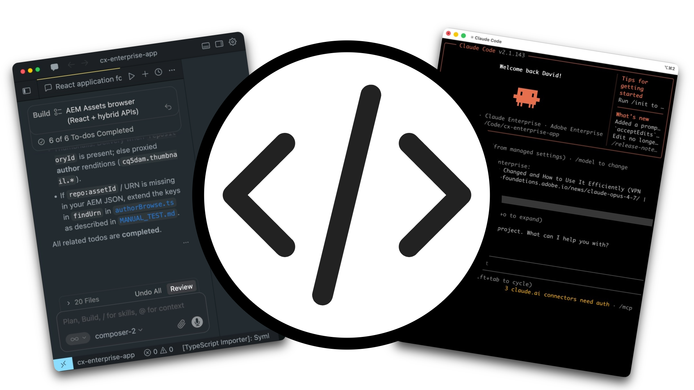
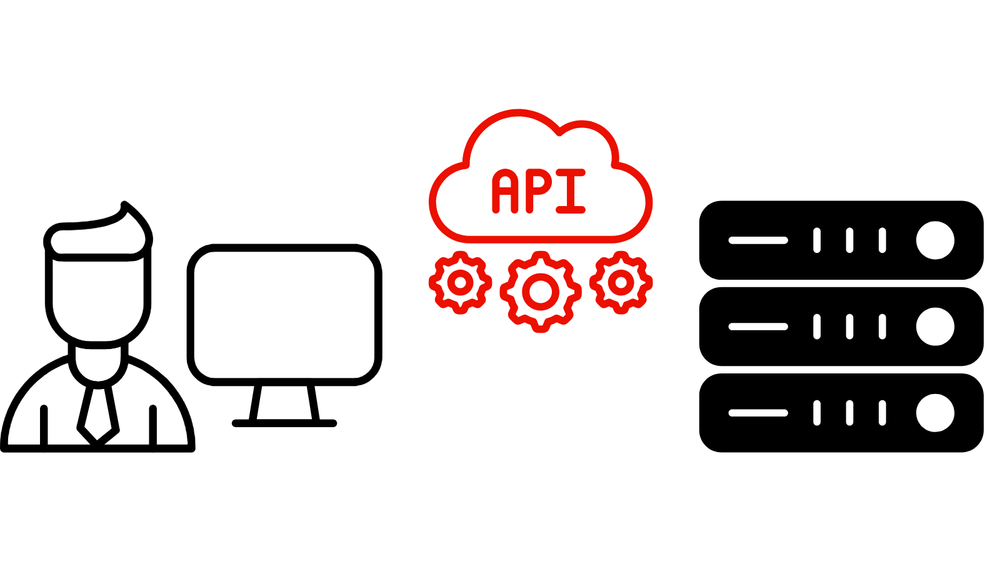

# API para creadores

<!-- last-modified: 2026-06-02 -->



Las API de Adobe CX Enterprise proporcionan a los desarrolladores y a las herramientas agénticas de codificación asistida por IA acceso directo a los datos y flujos de trabajo de Adobe. Utilícelos para crear aplicaciones personalizadas, automatizar integraciones e incrustar las funcionalidades de Adobe en sus propios sistemas. Las API son la elección correcta cuando necesita un control programático completo de una integración de sistema o cuando está creando una aplicación sobre los datos de Adobe. Para obtener acceso conversacional a los flujos de trabajo de Adobe impulsado por el agente, consulte [servidores MCP](mcp-servers.md).

## API de Adobe CX para empresas

>[!BEGINTABS]

>[!TAB Adobe Analytics]

Informes, fuentes de datos, métricas calculadas y administración de segmentos.

[Explorar API](https://developer.adobe.com/analytics-apis/docs/2.0/)

>[!TAB Adobe Commerce]

API de REST y GraphQL para catálogos, carros de compras, pedidos, clientes y promociones.

[Explorar API](https://developer.adobe.com/commerce/webapi/)

>[!TAB Adobe Experience Platform]

Operaciones de CRUD para conjuntos de datos, esquemas, perfiles, identidades, consultas y segmentación.

[Explorar API](https://developer.adobe.com/experience-platform-apis/)

>[!TAB Adobe Journey Optimizer]

orquestación de recorrido, administración de campañas, plantillas de contenido y Offer Decisioning.

[Explorar API](https://developer.adobe.com/journey-optimizer-apis/)

>[!TAB AEM as a Cloud Service]

API de administración de contenido, recursos y flujos de trabajo para Adobe Experience Manager.

[Explorar API](https://experienceleague.adobe.com/en/docs/experience-manager-cloud-service/content/implementing/developing/apis-and-extensions)

>[!TAB Audience Manager]

Flujos de trabajo de activación y gestión de público.

[Explorar API](https://developer.adobe.com/audience-manager/)

>[!TAB SDK de cliente]

SDK móviles, SDK Edge y mensajería en la aplicación.

[Explorar API](https://developer.adobe.com/client-sdks/home/)

>[!TAB Customer Journey Analytics]

Flujos de trabajo de acceso a datos, informes y perspectivas de CJA de Analytics.

[Explorar API](https://developer.adobe.com/cja-apis/docs/)

>[!TAB Recopilación de datos]

Ingesta de datos de Edge Network, recopilación de eventos en tiempo real y entrega de datos de streaming.

[Explorar API](https://developer.adobe.com/data-collection-apis/docs/)

>[!TAB Developer Console]

Configuración, autenticación y administración de credenciales del proyecto de API.

[Explorar API](https://developer.adobe.com/developer-console/docs/guides/)

>[!TAB Eventos]

Integraciones impulsadas por eventos, webhooks y déclencheur de automatización.

[Explorar API](https://developer.adobe.com/events/docs/)

>[!TAB Privacidad]

Flujos de trabajo de privacidad, control de datos y solicitudes de titulares de los datos.

[Explorar API](https://experienceleague.adobe.com/es/docs/experience-platform/privacy/home)

>[!TAB Administración de usuarios]

Administración de usuarios, administración de identidades y automatización de cuentas empresariales.

[Explorar API](https://developer.adobe.com/umapi/)

>[!ENDTABS]

## Compilación con API


Los agentes de codificación como Claude Code, Cursor y OpenAI Codex son muy adecuados para la creación con las API de Adobe CX Enterprise. Añada una especificación OpenAPI al proyecto para que el agente pueda descubrir puntos finales, construir solicitudes y razonar sobre el comportamiento de la API sin cableado manual. Para empezar, necesita dos cosas: credenciales autenticadas de Adobe Developer Console y documentación de API agregadas al proyecto.

### Configuración de credenciales de API en Adobe Developer Console

Todo el acceso a la API de Adobe CX Enterprise se administra mediante [Adobe Developer Console](https://developer.adobe.com/developer-console/docs/guides/). Cree un proyecto, añada las API que necesita la aplicación y genere credenciales.

1. Inicie sesión y [cree un proyecto](https://developer.adobe.com/developer-console/docs/guides/projects/) en Adobe Developer Console.
2. [Agregue la API](https://developer.adobe.com/developer-console/docs/guides/services/) para la aplicación Adobe CX Enterprise que necesita.
3. Elija un [tipo de autenticación](https://developer.adobe.com/developer-console/docs/guides/authentication/). Utilice **OAuth Server-to-Server** para flujos de trabajo automatizados o **OAuth Web App** para aplicaciones orientadas al usuario.
4. Genere sus credenciales. Tenga en cuenta el ID de cliente, el secreto de cliente y el extremo de token para su uso en la aplicación.

La mayoría de las API empresariales de Adobe CX requieren licencias de aplicación. Si una API no está disponible en el proyecto de Developer Console, póngase en contacto con su representante de Adobe.

### Añada el contexto de la API de Adobe a su proyecto

Los agentes de codificación de IA pueden descubrir y utilizar las API de Adobe de forma fiable al añadir el material de referencia adecuado al proyecto. Esto funciona para cualquier API de Adobe CX Enterprise que publique una especificación de OpenAPI.

**1. Buscar la especificación de API**

Examine las [API de Adobe CX Enterprise](#adobe-cx-enterprise-apis) enumeradas anteriormente o vaya directamente al [catálogo de API de Adobe Developer](https://developer.adobe.com/apis).

**2. Descargar la especificación de OpenAPI**

Cree un directorio `/specs` en su proyecto. Descargue OpenAPI YAML desde la página Referencias de la API en [developer.adobe.com](https://developer.adobe.com/apis) y guárdela allí. Agregue un(a) `README.md` registrando la URL de origen y la fecha de descarga.

```
/specs/README.md
/specs/aem-assets.openapi.yaml
```

>[!TIP]
>Una captura de pantalla protegida proporciona a su agente de codificación un comportamiento estable y reproducible, y hace que los cambios de API sean visibles en su historial de Git.

**3. Generar un índice de API**

Pegue este mensaje en su agente de codificación y reemplace `<API-SPEC-FILE>` por su nombre de archivo:

```
Read /specs/<API-SPEC-FILE>.openapi.yaml and generate /docs/<API-SPEC-FILE>.api.md.

Create a concise API index for AI coding agents. For each operation include: operationId, HTTP method, path, purpose, authentication requirements, required inputs, response shape, common error responses, pagination behavior, asynchronous behavior, and deprecation status.

Do not invent endpoints, parameters, request bodies, response fields, or behavior not present in the OpenAPI specification.
```

**4. Generar instrucciones del agente**

```
Read /specs/<API-SPEC-FILE>.openapi.yaml and /docs/<API-SPEC-FILE>.api.md.

Generate AGENTS.md. Instructions should:
- Treat the OpenAPI specification as the source of truth.
- Use the API index as a navigation guide.
- Never invent endpoints, parameters, response fields, or status codes.
- Prefer documented operationIds.
- Avoid deprecated or experimental APIs unless explicitly requested.
- Follow authentication requirements defined in the specification.
- Use the local OpenAPI snapshot for implementation decisions.
```

**5. Verificar**

Solicite al agente de codificación que complete una tarea sencilla utilizando únicamente los archivos generados:

```
Write a function that takes an AEM asset ID and returns the asset title and description. Use only /specs/aem-assets.openapi.yaml and /docs/aem-assets.api.md.
```

Si el agente lo completa correctamente sin inventar el comportamiento, la configuración se completa.

**Estructura de proyecto recomendada**

```
project/
├── specs/
│   ├── README.md
│   └── aem-assets.openapi.yaml
├── docs/
│   └── aem-assets.api.md
└── AGENTS.md
```

**Manteniendo las especificaciones actualizadas**

Cuando Adobe publique una nueva versión de la API: descargue una instantánea nueva en `/specs`, actualice la fecha en `README.md` y vuelva a generar el índice y `AGENTS.md`.

## API en acción

Las API proporcionan a los equipos de desarrollo un control programático completo para crear aplicaciones centradas que automaticen flujos de trabajo empresariales específicos de CX. Estos tutoriales muestran integraciones reales creadas de principio a fin, desde la configuración de credenciales hasta el código de trabajo que su organización puede enviar.

<!--
CARDS

* https://experienceleague.adobe.com/en/docs/experience-manager-learn/cloud-service/aem-apis/openapis/invoke-api-using-oauth-web-app
  {title = Invoke AEM APIs from a web app}
  {description = Build a web application that authenticates users and calls AEM OpenAPIs using OAuth to deliver governed, programmatic access.}
  {cta = Try with APIs}
  {image = ../assets/using-api-card.png}

-->
<!-- START CARDS HTML - DO NOT MODIFY BY HAND -->
<div class="columns">
    <div class="column is-half-tablet is-half-desktop is-one-third-widescreen" aria-label="Invoke AEM APIs from a web app">
        <div class="card" style="height: 100%; display: flex; flex-direction: column; height: 100%;">
            <div class="card-image">
                <figure class="image x-is-16by9">
                    <a href="https://experienceleague.adobe.com/en/docs/experience-manager-learn/cloud-service/aem-apis/openapis/invoke-api-using-oauth-web-app" title="Invocar las API de AEM desde una aplicación web" target="_blank" rel="referrer">
                        
                    </a>
                </figure>
            </div>
            <div class="card-content is-padded-small" style="display: flex; flex-direction: column; flex-grow: 1; justify-content: space-between;">
                <div class="top-card-content">
                    <p class="headline is-size-6 has-text-weight-bold">
                        <a href="https://experienceleague.adobe.com/en/docs/experience-manager-learn/cloud-service/aem-apis/openapis/invoke-api-using-oauth-web-app" target="_blank" rel="referrer" title="Invocar las API de AEM desde una aplicación web">Invocar las API de AEM desde una aplicación web</a>
                    </p>
                    <p class="is-size-6">Cree una aplicación web que autentique usuarios y llame a las API abiertas de AEM mediante OAuth para ofrecer acceso controlado y programático.</p>
                </div>
                <a href="https://experienceleague.adobe.com/en/docs/experience-manager-learn/cloud-service/aem-apis/openapis/invoke-api-using-oauth-web-app" target="_blank" rel="referrer" class="spectrum-Button spectrum-Button--outline spectrum-Button--primary spectrum-Button--sizeM" style="align-self: flex-start; margin-top: 1rem;">
                    <span class="spectrum-Button-label has-no-wrap has-text-weight-bold">Probar con API</span>
                
            </div>
        </div>
    </div>
</div>
<!-- END CARDS HTML - DO NOT MODIFY BY HAND -->
