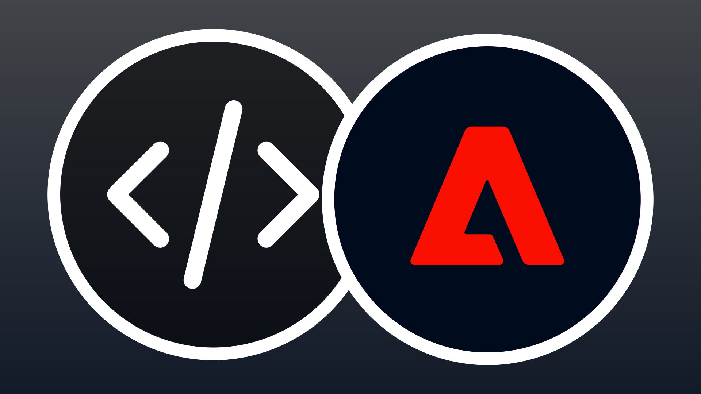

# API para generadores

<!-- last-modified: 2026-06-02 -->


Las API de Adobe CX Enterprise proporcionan a los desarrolladores y a las herramientas agénticas de codificación asistida por IA acceso directo a los datos y flujos de trabajo de Adobe. Utilícelos para crear aplicaciones personalizadas, automatizar integraciones e incrustar las funcionalidades de Adobe en sus propios sistemas. Las API son la elección correcta cuando necesita un control programático completo de una integración de sistema o cuando está creando una aplicación sobre los datos de Adobe. Para obtener acceso conversacional a los flujos de trabajo de Adobe impulsado por el agente, consulte [servidores MCP](mcp-servers.md).

## API de Adobe CX para empresas

<!--
CARDS

* https://developer.adobe.com/audience-manager/
  {title = Audience Manager}
  {description = Audience management and activation workflows.}
  {cta = Explore API}
  {target = _blank}
  {image = ../assets/apis-aam-card.png}

* https://developer.adobe.com/client-sdks/home/
  {title = Client SDKs}
  {description = Mobile SDKs, edge SDKs, and in-app messaging.}
  {cta = Explore API}
  {target = _blank}
  {image = ../assets/apis-cxenterprise-card.png}

* https://developer.adobe.com/cja-apis/docs/
  {title = Customer Journey Analytics}
  {description = Analytics data access, reporting, and CJA insights workflows.}
  {cta = Explore API}
  {target = _blank}
  {image = ../assets/apis-cja-card.png}

* https://developer.adobe.com/data-collection-apis/docs/
  {title = Data Collection}
  {description = Edge Network data ingestion, real-time event collection, and streaming data delivery.}
  {cta = Explore API}
  {target = _blank}
  {image = ../assets/apis-aep-card.png}

* https://developer.adobe.com/developer-console/docs/guides/
  {title = Developer Console}
  {description = API project setup, authentication, and credential management.}
  {cta = Explore API}
  {target = _blank}
  {image = ../assets/apis-cxenterprise-card.png}

* https://developer.adobe.com/events/docs/
  {title = Events}
  {description = Event-driven integrations, webhooks, and automation triggers.}
  {cta = Explore API}
  {target = _blank}
  {image = ../assets/apis-cxenterprise-card.png}

* https://experienceleague.adobe.com/es/docs/experience-platform/privacy/home
  {title = Privacy}
  {description = Privacy workflows, data governance, and data subject requests.}
  {cta = Explore API}
  {target = _blank}
  {image = ../assets/apis-aep-card.png}

* https://developer.adobe.com/experience-platform-apis/
  {title = Adobe Experience Platform}
  {description = CRUD operations for datasets, schemas, profiles, identities, queries, and segmentation.}
  {cta = Explore API}
  {target = _blank}
  {image = ../assets/apis-aep-card.png}

* https://developer.adobe.com/journey-optimizer-apis/
  {title = Adobe Journey Optimizer}
  {description = Journey orchestration, campaign management, content templates, and offer decisioning.}
  {cta = Explore API}
  {target = _blank}
  {image = ../assets/apis-ajo-card.png}

* https://developer.adobe.com/analytics-apis/docs/2.0/
  {title = Adobe Analytics}
  {description = Reporting, data feeds, calculated metrics, and segment management.}
  {cta = Explore API}
  {target = _blank}
  {image = ../assets/apis-analytics-card.png}

* https://experienceleague.adobe.com/en/docs/experience-manager-cloud-service/content/implementing/developing/apis-and-extensions
  {title = AEM as a Cloud Service}
  {description = Content, asset, and workflow management APIs for Adobe Experience Manager.}
  {cta = Explore API}
  {target = _blank}
  {image = ../assets/apis-aem-card.png}

* https://developer.adobe.com/commerce/webapi/
  {title = Adobe Commerce}
  {description = REST and GraphQL APIs for catalog, cart, orders, customers, and promotions.}
  {cta = Explore API}
  {target = _blank}
  {image = ../assets/apis-commerce-card.png}

* https://developer.adobe.com/umapi/
  {title = User Management}
  {description = User management, identity administration, and enterprise account automation.}
  {cta = Explore API}
  {target = _blank}
  {image = ../assets/apis-cxenterprise-card.png}
-->
<!-- START CARDS HTML - DO NOT MODIFY BY HAND -->
<div class="columns">
    <div class="column is-half-tablet is-half-desktop is-one-third-widescreen" aria-label="Audience Manager">
        <div class="card" style="height: 100%; display: flex; flex-direction: column; height: 100%;">
            <div class="card-image">
                <figure class="image x-is-16by9">
                    <a href="https://developer.adobe.com/audience-manager/" title="Audience Manager" target="_blank" rel="referrer">
                        
                    </a>
                </figure>
            </div>
            <div class="card-content is-padded-small" style="display: flex; flex-direction: column; flex-grow: 1; justify-content: space-between;">
                <div class="top-card-content">
                    <p class="headline is-size-6 has-text-weight-bold">
                        <a href="https://developer.adobe.com/audience-manager/" target="_blank" rel="referrer" title="Audience Manager">Audience Manager</a>
                    </p>
                    <p class="is-size-6">Flujos de trabajo de activación y gestión de público.</p>
                </div>
                <a href="https://developer.adobe.com/audience-manager/" target="_blank" rel="referrer" class="spectrum-Button spectrum-Button--outline spectrum-Button--primary spectrum-Button--sizeM" style="align-self: flex-start; margin-top: 1rem;">
                    <span class="spectrum-Button-label has-no-wrap has-text-weight-bold">Explorar API</span>
                </a>
            </div>
        </div>
    </div>
    <div class="column is-half-tablet is-half-desktop is-one-third-widescreen" aria-label="Client SDKs">
        <div class="card" style="height: 100%; display: flex; flex-direction: column; height: 100%;">
            <div class="card-image">
                <figure class="image x-is-16by9">
                    <a href="https://developer.adobe.com/client-sdks/home/" title="SDK de cliente" target="_blank" rel="referrer">
                        
                    </a>
                </figure>
            </div>
            <div class="card-content is-padded-small" style="display: flex; flex-direction: column; flex-grow: 1; justify-content: space-between;">
                <div class="top-card-content">
                    <p class="headline is-size-6 has-text-weight-bold">
                        <a href="https://developer.adobe.com/client-sdks/home/" target="_blank" rel="referrer" title="SDK de cliente">SDK de cliente</a>
                    </p>
                    <p class="is-size-6">SDK móviles, SDK Edge y mensajería en la aplicación.</p>
                </div>
                <a href="https://developer.adobe.com/client-sdks/home/" target="_blank" rel="referrer" class="spectrum-Button spectrum-Button--outline spectrum-Button--primary spectrum-Button--sizeM" style="align-self: flex-start; margin-top: 1rem;">
                    <span class="spectrum-Button-label has-no-wrap has-text-weight-bold">Explorar API</span>
                </a>
            </div>
        </div>
    </div>
    <div class="column is-half-tablet is-half-desktop is-one-third-widescreen" aria-label="Customer Journey Analytics">
        <div class="card" style="height: 100%; display: flex; flex-direction: column; height: 100%;">
            <div class="card-image">
                <figure class="image x-is-16by9">
                    <a href="https://developer.adobe.com/cja-apis/docs/" title="Customer Journey Analytics" target="_blank" rel="referrer">
                        
                    </a>
                </figure>
            </div>
            <div class="card-content is-padded-small" style="display: flex; flex-direction: column; flex-grow: 1; justify-content: space-between;">
                <div class="top-card-content">
                    <p class="headline is-size-6 has-text-weight-bold">
                        <a href="https://developer.adobe.com/cja-apis/docs/" target="_blank" rel="referrer" title="Customer Journey Analytics">Customer Journey Analytics</a>
                    </p>
                    <p class="is-size-6">Flujos de trabajo de acceso a datos, informes y perspectivas de CJA de Analytics.</p>
                </div>
                <a href="https://developer.adobe.com/cja-apis/docs/" target="_blank" rel="referrer" class="spectrum-Button spectrum-Button--outline spectrum-Button--primary spectrum-Button--sizeM" style="align-self: flex-start; margin-top: 1rem;">
                    <span class="spectrum-Button-label has-no-wrap has-text-weight-bold">Explorar API</span>
                </a>
            </div>
        </div>
    </div>
    <div class="column is-half-tablet is-half-desktop is-one-third-widescreen" aria-label="Data Collection">
        <div class="card" style="height: 100%; display: flex; flex-direction: column; height: 100%;">
            <div class="card-image">
                <figure class="image x-is-16by9">
                    <a href="https://developer.adobe.com/data-collection-apis/docs/" title="Recopilación de datos" target="_blank" rel="referrer">
                        
                    </a>
                </figure>
            </div>
            <div class="card-content is-padded-small" style="display: flex; flex-direction: column; flex-grow: 1; justify-content: space-between;">
                <div class="top-card-content">
                    <p class="headline is-size-6 has-text-weight-bold">
                        <a href="https://developer.adobe.com/data-collection-apis/docs/" target="_blank" rel="referrer" title="Recopilación de datos">Recopilación de datos</a>
                    </p>
                    <p class="is-size-6">Ingesta de datos de Edge Network, recopilación de eventos en tiempo real y entrega de datos de streaming.</p>
                </div>
                <a href="https://developer.adobe.com/data-collection-apis/docs/" target="_blank" rel="referrer" class="spectrum-Button spectrum-Button--outline spectrum-Button--primary spectrum-Button--sizeM" style="align-self: flex-start; margin-top: 1rem;">
                    <span class="spectrum-Button-label has-no-wrap has-text-weight-bold">Explorar API</span>
                </a>
            </div>
        </div>
    </div>
    <div class="column is-half-tablet is-half-desktop is-one-third-widescreen" aria-label="Developer Console">
        <div class="card" style="height: 100%; display: flex; flex-direction: column; height: 100%;">
            <div class="card-image">
                <figure class="image x-is-16by9">
                    <a href="https://developer.adobe.com/developer-console/docs/guides/" title="Developer Console" target="_blank" rel="referrer">
                        
                    </a>
                </figure>
            </div>
            <div class="card-content is-padded-small" style="display: flex; flex-direction: column; flex-grow: 1; justify-content: space-between;">
                <div class="top-card-content">
                    <p class="headline is-size-6 has-text-weight-bold">
                        <a href="https://developer.adobe.com/developer-console/docs/guides/" target="_blank" rel="referrer" title="Developer Console">Developer Console</a>
                    </p>
                    <p class="is-size-6">Configuración, autenticación y administración de credenciales del proyecto de API.</p>
                </div>
                <a href="https://developer.adobe.com/developer-console/docs/guides/" target="_blank" rel="referrer" class="spectrum-Button spectrum-Button--outline spectrum-Button--primary spectrum-Button--sizeM" style="align-self: flex-start; margin-top: 1rem;">
                    <span class="spectrum-Button-label has-no-wrap has-text-weight-bold">Explorar API</span>
                </a>
            </div>
        </div>
    </div>
    <div class="column is-half-tablet is-half-desktop is-one-third-widescreen" aria-label="Events">
        <div class="card" style="height: 100%; display: flex; flex-direction: column; height: 100%;">
            <div class="card-image">
                <figure class="image x-is-16by9">
                    <a href="https://developer.adobe.com/events/docs/" title="Eventos" target="_blank" rel="referrer">
                        
                    </a>
                </figure>
            </div>
            <div class="card-content is-padded-small" style="display: flex; flex-direction: column; flex-grow: 1; justify-content: space-between;">
                <div class="top-card-content">
                    <p class="headline is-size-6 has-text-weight-bold">
                        <a href="https://developer.adobe.com/events/docs/" target="_blank" rel="referrer" title="Eventos">Eventos</a>
                    </p>
                    <p class="is-size-6">Integraciones impulsadas por eventos, webhooks y déclencheur de automatización.</p>
                </div>
                <a href="https://developer.adobe.com/events/docs/" target="_blank" rel="referrer" class="spectrum-Button spectrum-Button--outline spectrum-Button--primary spectrum-Button--sizeM" style="align-self: flex-start; margin-top: 1rem;">
                    <span class="spectrum-Button-label has-no-wrap has-text-weight-bold">Explorar API</span>
                </a>
            </div>
        </div>
    </div>
    <div class="column is-half-tablet is-half-desktop is-one-third-widescreen" aria-label="Privacy">
        <div class="card" style="height: 100%; display: flex; flex-direction: column; height: 100%;">
            <div class="card-image">
                <figure class="image x-is-16by9">
                    <a href="https://experienceleague.adobe.com/es/docs/experience-platform/privacy/home" title="Privacidad" target="_blank" rel="referrer">
                        
                    </a>
                </figure>
            </div>
            <div class="card-content is-padded-small" style="display: flex; flex-direction: column; flex-grow: 1; justify-content: space-between;">
                <div class="top-card-content">
                    <p class="headline is-size-6 has-text-weight-bold">
                        <a href="https://experienceleague.adobe.com/es/docs/experience-platform/privacy/home" target="_blank" rel="referrer" title="Privacidad">Privacidad</a>
                    </p>
                    <p class="is-size-6">Flujos de trabajo de privacidad, control de datos y solicitudes de titulares de los datos.</p>
                </div>
                <a href="https://experienceleague.adobe.com/es/docs/experience-platform/privacy/home" target="_blank" rel="referrer" class="spectrum-Button spectrum-Button--outline spectrum-Button--primary spectrum-Button--sizeM" style="align-self: flex-start; margin-top: 1rem;">
                    <span class="spectrum-Button-label has-no-wrap has-text-weight-bold">Explorar API</span>
                </a>
            </div>
        </div>
    </div>
    <div class="column is-half-tablet is-half-desktop is-one-third-widescreen" aria-label="Adobe Experience Platform">
        <div class="card" style="height: 100%; display: flex; flex-direction: column; height: 100%;">
            <div class="card-image">
                <figure class="image x-is-16by9">
                    <a href="https://developer.adobe.com/experience-platform-apis/" title="Adobe Experience Platform" target="_blank" rel="referrer">
                        
                    </a>
                </figure>
            </div>
            <div class="card-content is-padded-small" style="display: flex; flex-direction: column; flex-grow: 1; justify-content: space-between;">
                <div class="top-card-content">
                    <p class="headline is-size-6 has-text-weight-bold">
                        <a href="https://developer.adobe.com/experience-platform-apis/" target="_blank" rel="referrer" title="Adobe Experience Platform">Adobe Experience Platform</a>
                    </p>
                    <p class="is-size-6">Operaciones de CRUD para conjuntos de datos, esquemas, perfiles, identidades, consultas y segmentación.</p>
                </div>
                <a href="https://developer.adobe.com/experience-platform-apis/" target="_blank" rel="referrer" class="spectrum-Button spectrum-Button--outline spectrum-Button--primary spectrum-Button--sizeM" style="align-self: flex-start; margin-top: 1rem;">
                    <span class="spectrum-Button-label has-no-wrap has-text-weight-bold">Explorar API</span>
                </a>
            </div>
        </div>
    </div>
    <div class="column is-half-tablet is-half-desktop is-one-third-widescreen" aria-label="Adobe Journey Optimizer">
        <div class="card" style="height: 100%; display: flex; flex-direction: column; height: 100%;">
            <div class="card-image">
                <figure class="image x-is-16by9">
                    <a href="https://developer.adobe.com/journey-optimizer-apis/" title="Adobe Journey Optimizer" target="_blank" rel="referrer">
                        
                    </a>
                </figure>
            </div>
            <div class="card-content is-padded-small" style="display: flex; flex-direction: column; flex-grow: 1; justify-content: space-between;">
                <div class="top-card-content">
                    <p class="headline is-size-6 has-text-weight-bold">
                        <a href="https://developer.adobe.com/journey-optimizer-apis/" target="_blank" rel="referrer" title="Adobe Journey Optimizer">Adobe Journey Optimizer</a>
                    </p>
                    <p class="is-size-6">orquestación de recorrido, administración de campañas, plantillas de contenido y Offer Decisioning.</p>
                </div>
                <a href="https://developer.adobe.com/journey-optimizer-apis/" target="_blank" rel="referrer" class="spectrum-Button spectrum-Button--outline spectrum-Button--primary spectrum-Button--sizeM" style="align-self: flex-start; margin-top: 1rem;">
                    <span class="spectrum-Button-label has-no-wrap has-text-weight-bold">Explorar API</span>
                </a>
            </div>
        </div>
    </div>
    <div class="column is-half-tablet is-half-desktop is-one-third-widescreen" aria-label="Adobe Analytics">
        <div class="card" style="height: 100%; display: flex; flex-direction: column; height: 100%;">
            <div class="card-image">
                <figure class="image x-is-16by9">
                    <a href="https://developer.adobe.com/analytics-apis/docs/2.0/" title="Adobe Analytics" target="_blank" rel="referrer">
                        
                    </a>
                </figure>
            </div>
            <div class="card-content is-padded-small" style="display: flex; flex-direction: column; flex-grow: 1; justify-content: space-between;">
                <div class="top-card-content">
                    <p class="headline is-size-6 has-text-weight-bold">
                        <a href="https://developer.adobe.com/analytics-apis/docs/2.0/" target="_blank" rel="referrer" title="Adobe Analytics">Adobe Analytics</a>
                    </p>
                    <p class="is-size-6">Informes, fuentes de datos, métricas calculadas y administración de segmentos.</p>
                </div>
                <a href="https://developer.adobe.com/analytics-apis/docs/2.0/" target="_blank" rel="referrer" class="spectrum-Button spectrum-Button--outline spectrum-Button--primary spectrum-Button--sizeM" style="align-self: flex-start; margin-top: 1rem;">
                    <span class="spectrum-Button-label has-no-wrap has-text-weight-bold">Explorar API</span>
                </a>
            </div>
        </div>
    </div>
    <div class="column is-half-tablet is-half-desktop is-one-third-widescreen" aria-label="Adobe Commerce">
        <div class="card" style="height: 100%; display: flex; flex-direction: column; height: 100%;">
            <div class="card-image">
                <figure class="image x-is-16by9">
                    <a href="https://developer.adobe.com/commerce/webapi/" title="Adobe Commerce" target="_blank" rel="referrer">
                        
                    </a>
                </figure>
            </div>
            <div class="card-content is-padded-small" style="display: flex; flex-direction: column; flex-grow: 1; justify-content: space-between;">
                <div class="top-card-content">
                    <p class="headline is-size-6 has-text-weight-bold">
                        <a href="https://developer.adobe.com/commerce/webapi/" target="_blank" rel="referrer" title="Adobe Commerce">Adobe Commerce</a>
                    </p>
                    <p class="is-size-6">API de REST y GraphQL para catálogos, carros de compras, pedidos, clientes y promociones.</p>
                </div>
                <a href="https://developer.adobe.com/commerce/webapi/" target="_blank" rel="referrer" class="spectrum-Button spectrum-Button--outline spectrum-Button--primary spectrum-Button--sizeM" style="align-self: flex-start; margin-top: 1rem;">
                    <span class="spectrum-Button-label has-no-wrap has-text-weight-bold">Explorar API</span>
                </a>
            </div>
        </div>
    </div>
    <div class="column is-half-tablet is-half-desktop is-one-third-widescreen" aria-label="User Management">
        <div class="card" style="height: 100%; display: flex; flex-direction: column; height: 100%;">
            <div class="card-image">
                <figure class="image x-is-16by9">
                    <a href="https://developer.adobe.com/umapi/" title="Administración de usuarios" target="_blank" rel="referrer">
                        
                    </a>
                </figure>
            </div>
            <div class="card-content is-padded-small" style="display: flex; flex-direction: column; flex-grow: 1; justify-content: space-between;">
                <div class="top-card-content">
                    <p class="headline is-size-6 has-text-weight-bold">
                        <a href="https://developer.adobe.com/umapi/" target="_blank" rel="referrer" title="Administración de usuarios">Administración de usuarios</a>
                    </p>
                    <p class="is-size-6">Administración de usuarios, administración de identidades y automatización de cuentas empresariales.</p>
                </div>
                <a href="https://developer.adobe.com/umapi/" target="_blank" rel="referrer" class="spectrum-Button spectrum-Button--outline spectrum-Button--primary spectrum-Button--sizeM" style="align-self: flex-start; margin-top: 1rem;">
                    <span class="spectrum-Button-label has-no-wrap has-text-weight-bold">Explorar API</span>
                </a>
            </div>
        </div>
    </div>
</div>
<!-- END CARDS HTML - DO NOT MODIFY BY HAND -->

## Introducción a las API para generadores


Las API de Adobe CX Enterprise requieren dos cosas antes de poder crearse: credenciales autenticadas de Adobe Developer Console y documentación de API agregada al proyecto para que el agente de codificación pueda trabajar con las API de Adobe de forma fiable.

### Configuración de credenciales de API en Adobe Developer Console

Todo el acceso a la API de Adobe CX Enterprise se administra mediante [Adobe Developer Console](https://developer.adobe.com/developer-console/docs/guides/). Cree un proyecto, añada las API que necesita la aplicación y genere credenciales.

1. Inicie sesión y [cree un proyecto](https://developer.adobe.com/developer-console/docs/guides/projects/) en Adobe Developer Console.
2. [Agregue la API](https://developer.adobe.com/developer-console/docs/guides/services/) para la aplicación Adobe CX Enterprise que necesita.
3. Elija un [tipo de autenticación](https://developer.adobe.com/developer-console/docs/guides/authentication/). Utilice **OAuth Server-to-Server** para flujos de trabajo automatizados o **OAuth Web App** para aplicaciones orientadas al usuario.
4. Genere sus credenciales. Tenga en cuenta el ID de cliente, el secreto de cliente y el extremo de token para su uso en la aplicación.

La mayoría de las API empresariales de Adobe CX requieren licencias de aplicación. Si una API no está disponible en el proyecto de Developer Console, póngase en contacto con su representante de Adobe.

### Añada el contexto de la API de Adobe a su proyecto

Los agentes de codificación de IA pueden descubrir y utilizar las API de Adobe de forma fiable al añadir el material de referencia adecuado al proyecto. Esto funciona para cualquier API de Adobe CX Enterprise que publique una especificación de OpenAPI.

**1. Buscar la especificación de API**

Examine las [API de Adobe CX Enterprise](#adobe-cx-enterprise-apis) enumeradas anteriormente o vaya directamente al [catálogo de API de Adobe Developer](https://developer.adobe.com/apis).

**2. Descargar la especificación de OpenAPI**

Cree un directorio `/specs` en su proyecto. Descargue OpenAPI YAML desde la página Referencias de la API en [developer.adobe.com](https://developer.adobe.com/apis) y guárdela allí. Agregue un(a) `README.md` registrando la URL de origen y la fecha de descarga.

```
/specs/README.md
/specs/aem-assets.openapi.yaml
```

>[!TIP]
>Una captura de pantalla protegida proporciona a su agente de codificación un comportamiento estable y reproducible, y hace que los cambios de API sean visibles en su historial de Git.

**3. Generar un índice de API**

Pegue este mensaje en su agente de codificación y reemplace `<API-SPEC-FILE>` por su nombre de archivo:

```
Read /specs/<API-SPEC-FILE>.openapi.yaml and generate /docs/<API-SPEC-FILE>.api.md.

Create a concise API index for AI coding agents. For each operation include: operationId, HTTP method, path, purpose, authentication requirements, required inputs, response shape, common error responses, pagination behavior, asynchronous behavior, and deprecation status.

Do not invent endpoints, parameters, request bodies, response fields, or behavior not present in the OpenAPI specification.
```

**4. Generar instrucciones del agente**

```
Read /specs/<API-SPEC-FILE>.openapi.yaml and /docs/<API-SPEC-FILE>.api.md.

Generate AGENTS.md. Instructions should:
- Treat the OpenAPI specification as the source of truth.
- Use the API index as a navigation guide.
- Never invent endpoints, parameters, response fields, or status codes.
- Prefer documented operationIds.
- Avoid deprecated or experimental APIs unless explicitly requested.
- Follow authentication requirements defined in the specification.
- Use the local OpenAPI snapshot for implementation decisions.
```

**5. Verificar**

Solicite al agente de codificación que complete una tarea sencilla utilizando únicamente los archivos generados:

```
Write a function that takes an AEM asset ID and returns the asset title and description. Use only /specs/aem-assets.openapi.yaml and /docs/aem-assets.api.md.
```

Si el agente lo completa correctamente sin inventar el comportamiento, la configuración se completa.

**Estructura de proyecto recomendada**

```
project/
├── specs/
│   ├── README.md
│   └── aem-assets.openapi.yaml
├── docs/
│   └── aem-assets.api.md
└── AGENTS.md
```

**Manteniendo las especificaciones actualizadas**

Cuando Adobe publique una nueva versión de la API: descargue una instantánea nueva en `/specs`, actualice la fecha en `README.md` y vuelva a generar el índice y `AGENTS.md`.

## API para generadores y servidores MCP

Utilice las API cuando necesite un control total sobre la integración del sistema o esté creando una aplicación personalizada. Utilice los servidores MCP cuando desee que un agente de IA trabaje directamente con flujos de trabajo de Adobe.

| | API | Servidores MCP |
| --- | --- | --- |
| Integración directa del sistema | Sí | A veces |
| Orquestación compatible con agentes | Limitado | Sí |
| Acceso a datos sin procesar | Sí | Generalmente abstracto |
| Desarrollo de aplicaciones personalizadas | Caso de uso principal | Secundario |
| Flujos de trabajo asistidos por IA | Admitido | Caso de uso principal |
