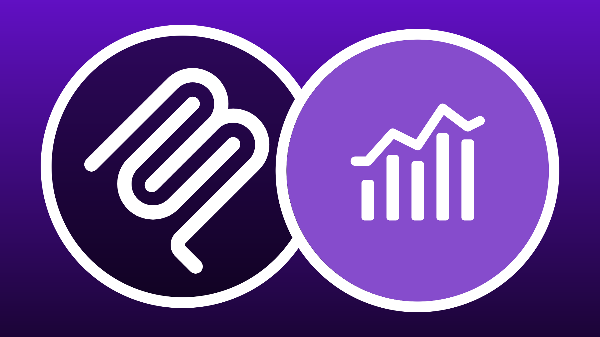

# Servidores MCP

<!-- last-modified: 2026-05-19 -->

>[!VIDEO](https://video.tv.adobe.com/v/3491320/?learn=on&enablevpops)

Los servidores MCP empresariales de Adobe CX proporcionan a cualquier cliente de IA compatible acceso directo y controlado a los datos y flujos de trabajo de Adobe. Conéctese una vez y podrá consultar el rendimiento de la campaña, activar audiencias, revisar recorridos, administrar contenido y mucho más, todo en un lenguaje sencillo, sin salir de su entorno de IA. Debido a que los servidores MCP se encuentran entre su cliente de IA y los sistemas subyacentes de Adobe, obtiene flexibilidad en lenguaje natural mientras los controles de acceso y la gobernanza de datos de su organización permanecen vigentes.

Los servidores MCP de Adobe siguen el estándar abierto de Model Context Protocol. Cualquier cliente de IA compatible con MCP se conecta a cualquier servidor MCP de Adobe.

## CX Enterprise MCP Gateway


**Un extremo. Cada servidor MCP empresarial de Adobe CX.**

CX Enterprise Gateway enruta a su cliente de IA a herramientas a través de Analytics, Campañas, Contenido y Datos, sin una conexión separada para cada aplicación. Conéctese una vez y la puerta de enlace solo mostrará las herramientas para las que tiene licencia su organización, en función de sus derechos de Adobe.

>[!BEGINTABS]

>[!TAB Aplicaciones empresariales de CX]

Las herramientas de cada aplicación están disponibles en función de las licencias de Adobe de su organización.

| Aplicación | Lo que puede hacer |
| --- | --- |
| Adobe Journey Optimizer | [Revisar recorridos, campañas y configuraciones de canal](https://developer.adobe.com/ai-registry/#/mcp/ajo-mcp-server) |
| Customer Journey Analytics | [Informes de consultas, descubrir vistas de datos, crear espacios de trabajo](https://developer.adobe.com/ai-registry/#/mcp/cja-mcp) |
| Real-Time CDP | [Comprobar destinos, estado de activación y estado del flujo de datos](https://experienceleague.adobe.com/en/docs/experience-cloud-ai/experience-cloud-ai/mcp/rtcdp-mcp) (beta cerrada) |

>[!TAB Conectar]

Utilice el punto final de CX Enterprise Gateway siempre que desee utilizar un punto final de MCP específico de la aplicación.

```
https://cx-enterprise.adobe.io/mcp
```

>[!NOTE]
>Para AEM, utilice el extremo directo de AEM: AEM no se enruta a través de la puerta de enlace de MCP de CX Enterprise.

Inicie sesión con su Adobe ID cuando se le solicite y seleccione la organización de IMS vinculada a sus aplicaciones de Adobe. La elección de una organización incorrecta es la fuente más común de errores de autenticación o herramientas que faltan.

Para obtener instrucciones de configuración completas, consulta [Conectarse a tu cliente de IA](#connect-to-your-ai-client) a continuación.

>[!ENDTABS]

## Servidores MCP de Adobe CX Enterprise

Los servidores que se enumeran a continuación se conectan directamente y no se enrutan a través de CX Enterprise MCP Gateway. Para obtener acceso a AJO, Customer Journey Analytics y Real-Time CDP, use la [puerta de enlace de MCP empresarial de CX](#cx-enterprise-mcp-gateway) anterior.

<!--
CARDS

* #cx-enterprise-mcp-gateway
  {title = CX Enterprise MCP Gateway}
  {description = One connection to AJO, CJA, and Real-Time CDP tools. The gateway surfaces only the tools your organization is licensed for.}
  {cta = Connect}
  {image = ../assets/mcp-cxenterprise-card.png}

* https://developer.adobe.com/analytics-mcp/docs/aa/
  {title = Adobe Analytics}
  {description = Tools for report suite discovery, dimension and metric analysis, segment authoring, and workspace creation in Adobe Analytics.}
  {cta = View documentation}
  {target = _blank}
  {image = ../assets/mcp-analytics-card.png}

* https://experienceleague.adobe.com/en/docs/experience-manager-cloud-service/content/ai-in-aem/using-mcp-with-aem-as-a-cloud-service
  {title = AEM Content}
  {description = Tools for managing pages, content fragments, assets, and launches in Adobe Experience Manager as a Cloud Service using natural language.}
  {cta = View documentation}
  {target = _blank}
  {image = ../assets/mcp-aem-card.png}

* https://experienceleague.adobe.com/en/docs/experience-manager-cloud-service/content/ai-in-aem/using-mcp-with-aem-as-a-cloud-service
  {title = AEM Content (Read-Only)}
  {description = Tools for discovering and querying pages, content fragments, and launches in AEM as a Cloud Service. No write access.}
  {cta = View documentation}
  {target = _blank}
  {image = ../assets/mcp-aem-card.png}

* https://experienceleague.adobe.com/en/docs/experience-manager-learn/cloud-service/ai/mcp-servers/cloud-manager
  {title = AEM Cloud Manager}
  {description = Tools for managing Cloud Manager programs, environments, pipelines, and repositories from your IDE using natural language.}
  {cta = View documentation}
  {target = _blank}
  {image = ../assets/mcp-aem-card.png}

-->
<!-- START CARDS HTML - DO NOT MODIFY BY HAND -->
<div class="columns">
    <div class="column is-half-tablet is-half-desktop is-one-third-widescreen" aria-label="Adobe Analytics">
        <div class="card" style="height: 100%; display: flex; flex-direction: column; height: 100%;">
            <div class="card-image">
                <figure class="image x-is-16by9">
                    <a href="https://developer.adobe.com/analytics-mcp/docs/aa/" title="Adobe Analytics" target="_blank" rel="referrer">
                        
                    </a>
                </figure>
            </div>
            <div class="card-content is-padded-small" style="display: flex; flex-direction: column; flex-grow: 1; justify-content: space-between;">
                <div class="top-card-content">
                    <p class="headline is-size-6 has-text-weight-bold">
                        <a href="https://developer.adobe.com/analytics-mcp/docs/aa/" target="_blank" rel="referrer" title="Adobe Analytics">Adobe Analytics</a>
                    </p>
                    <p class="is-size-6">Herramientas para la detección de grupos de informes, análisis de dimensiones y métricas, creación de segmentos y creación de espacios de trabajo en Adobe Analytics.</p>
                </div>
                <a href="https://developer.adobe.com/analytics-mcp/docs/aa/" target="_blank" rel="referrer" class="spectrum-Button spectrum-Button--outline spectrum-Button--primary spectrum-Button--sizeM" style="align-self: flex-start; margin-top: 1rem;">
                    <span class="spectrum-Button-label has-no-wrap has-text-weight-bold">Ver documentación</span>
                </a>
            </div>
        </div>
    </div>
    <div class="column is-half-tablet is-half-desktop is-one-third-widescreen" aria-label="AEM Content">
        <div class="card" style="height: 100%; display: flex; flex-direction: column; height: 100%;">
            <div class="card-image">
                <figure class="image x-is-16by9">
                    <a href="https://experienceleague.adobe.com/en/docs/experience-manager-cloud-service/content/ai-in-aem/using-mcp-with-aem-as-a-cloud-service" title="Contenido de AEM" target="_blank" rel="referrer">
                        
                    </a>
                </figure>
            </div>
            <div class="card-content is-padded-small" style="display: flex; flex-direction: column; flex-grow: 1; justify-content: space-between;">
                <div class="top-card-content">
                    <p class="headline is-size-6 has-text-weight-bold">
                        <a href="https://experienceleague.adobe.com/en/docs/experience-manager-cloud-service/content/ai-in-aem/using-mcp-with-aem-as-a-cloud-service" target="_blank" rel="referrer" title="Contenido de AEM">Contenido de AEM</a>
                    </p>
                    <p class="is-size-6">Herramientas para administrar páginas, fragmentos de contenido, recursos y lanzamientos en Adobe Experience Manager as a Cloud Service mediante lenguaje natural.</p>
                </div>
                <a href="https://experienceleague.adobe.com/en/docs/experience-manager-cloud-service/content/ai-in-aem/using-mcp-with-aem-as-a-cloud-service" target="_blank" rel="referrer" class="spectrum-Button spectrum-Button--outline spectrum-Button--primary spectrum-Button--sizeM" style="align-self: flex-start; margin-top: 1rem;">
                    <span class="spectrum-Button-label has-no-wrap has-text-weight-bold">Ver documentación</span>
                </a>
            </div>
        </div>
    </div>
    <div class="column is-half-tablet is-half-desktop is-one-third-widescreen" aria-label="AEM Content (Read-Only)">
        <div class="card" style="height: 100%; display: flex; flex-direction: column; height: 100%;">
            <div class="card-image">
                <figure class="image x-is-16by9">
                    <a href="https://experienceleague.adobe.com/en/docs/experience-manager-cloud-service/content/ai-in-aem/using-mcp-with-aem-as-a-cloud-service" title="Contenido de AEM (solo lectura)" target="_blank" rel="referrer">
                        
                    </a>
                </figure>
            </div>
            <div class="card-content is-padded-small" style="display: flex; flex-direction: column; flex-grow: 1; justify-content: space-between;">
                <div class="top-card-content">
                    <p class="headline is-size-6 has-text-weight-bold">
                        <a href="https://experienceleague.adobe.com/en/docs/experience-manager-cloud-service/content/ai-in-aem/using-mcp-with-aem-as-a-cloud-service" target="_blank" rel="referrer" title="Contenido de AEM (solo lectura)">Contenido de AEM (solo lectura)</a>
                    </p>
                    <p class="is-size-6">Herramientas para detectar y consultar páginas, fragmentos de contenido e inicios en AEM as a Cloud Service. Sin acceso de escritura.</p>
                </div>
                <a href="https://experienceleague.adobe.com/en/docs/experience-manager-cloud-service/content/ai-in-aem/using-mcp-with-aem-as-a-cloud-service" target="_blank" rel="referrer" class="spectrum-Button spectrum-Button--outline spectrum-Button--primary spectrum-Button--sizeM" style="align-self: flex-start; margin-top: 1rem;">
                    <span class="spectrum-Button-label has-no-wrap has-text-weight-bold">Ver documentación</span>
                </a>
            </div>
        </div>
    </div>
    <div class="column is-half-tablet is-half-desktop is-one-third-widescreen" aria-label="AEM Cloud Manager">
        <div class="card" style="height: 100%; display: flex; flex-direction: column; height: 100%;">
            <div class="card-image">
                <figure class="image x-is-16by9">
                    <a href="https://experienceleague.adobe.com/es/docs/experience-manager-learn/cloud-service/ai/mcp-servers/cloud-manager" title="AEM Cloud Manager" target="_blank" rel="referrer">
                        
                    </a>
                </figure>
            </div>
            <div class="card-content is-padded-small" style="display: flex; flex-direction: column; flex-grow: 1; justify-content: space-between;">
                <div class="top-card-content">
                    <p class="headline is-size-6 has-text-weight-bold">
                        <a href="https://experienceleague.adobe.com/es/docs/experience-manager-learn/cloud-service/ai/mcp-servers/cloud-manager" target="_blank" rel="referrer" title="AEM Cloud Manager">AEM Cloud Manager</a>
                    </p>
                    <p class="is-size-6">Herramientas para administrar programas, entornos, canalizaciones y repositorios de Cloud Manager desde su IDE utilizando lenguaje natural.</p>
                </div>
                <a href="https://experienceleague.adobe.com/es/docs/experience-manager-learn/cloud-service/ai/mcp-servers/cloud-manager" target="_blank" rel="referrer" class="spectrum-Button spectrum-Button--outline spectrum-Button--primary spectrum-Button--sizeM" style="align-self: flex-start; margin-top: 1rem;">
                    <span class="spectrum-Button-label has-no-wrap has-text-weight-bold">Ver documentación</span>
                </a>
            </div>
        </div>
    </div>
</div>
<!-- END CARDS HTML - DO NOT MODIFY BY HAND -->


### Extremos del servidor MCP

| Servidor | Punto de conexión | Herramientas |
| --- | --- | --- |
| [Puerta de enlace MCP de CX Enterprise](#cx-enterprise-mcp-gateway) | `https://cx-enterprise.adobe.io/mcp` | · [Herramientas Adobe Journey Optimizer](https://developer.adobe.com/ai-registry/#/mcp/ajo-mcp-server)<br>· [Herramientas Customer Journey Analytics](https://developer.adobe.com/ai-registry/#/mcp/cja-mcp)<br>· [Herramientas Real-Time CDP](https://experienceleague.adobe.com/en/docs/experience-cloud-ai/experience-cloud-ai/mcp/rtcdp-mcp) |
| [Adobe Analytics](https://developer.adobe.com/analytics-mcp/docs/aa/) | `https://aa-mcp.adobe.io/mcp` | [Ver herramientas](https://developer.adobe.com/ai-registry/#/mcp/adobe-analytics-mcp) |
| [AEM Cloud Manager](https://experienceleague.adobe.com/es/docs/experience-manager-learn/cloud-service/ai/mcp-servers/cloud-manager) | `https://mcp.adobeaemcloud.com/adobe/mcp/cloudmanager` | [Ver herramientas](https://developer.adobe.com/ai-registry/#/mcp/aem-cloud-manager-mcp) |
| [Contenido de AEM](https://experienceleague.adobe.com/en/docs/experience-manager-cloud-service/content/ai-in-aem/using-mcp-with-aem-as-a-cloud-service) | `https://mcp.adobeaemcloud.com/adobe/mcp/content` | [Ver herramientas](https://developer.adobe.com/ai-registry/#/mcp/aem-content-mcp) |
| [Contenido de AEM (solo lectura)](https://experienceleague.adobe.com/en/docs/experience-manager-cloud-service/content/ai-in-aem/using-mcp-with-aem-as-a-cloud-service) | `https://mcp.adobeaemcloud.com/adobe/mcp/content-readonly` | [Ver herramientas](https://developer.adobe.com/ai-registry/#/mcp/aem-content-mcp-readonly) |

## Conexión a su cliente de IA

Todos los servidores MCP de Adobe utilizan OAuth con Adobe Identity Management Service (IMS). Seleccione la organización IMS correcta cuando se le solicite. La elección del incorrecto es la fuente más común de errores de autenticación.

Antes de realizar la configuración manualmente, compruebe en el [Registro de Adobe AI](https://developer.adobe.com/ai-registry/?type=connector) si hay un conector administrado para el cliente de IA y la aplicación de Adobe. Los conectores administrados gestionan la autenticación automáticamente. Si hay un conector disponible para su cliente y aplicación, utilícelo en lugar de los pasos manuales que se indican a continuación.


>[!BEGINTABS]

>[!TAB Claude.ai]

###  Usar un conector administrado

Vaya al [Registro de Adobe AI](https://developer.adobe.com/ai-registry/?type=connector) y busque su aplicación de Adobe. Si aparece un conector Claude (por ejemplo, el [conector Adobe Experience Manager](https://developer.adobe.com/ai-registry/#/connectors/adobe-experience-manager-connector)), siga sus instrucciones de configuración en lugar de los pasos siguientes.

### Conexión mediante un conector personalizado

Claude.ai admite servidores MCP remotos a través de conectores personalizados en la configuración de la cuenta.

1. Vaya a **Configuración > Integraciones**.
2. Haga clic en **Agregar conector personalizado**.
3. Escriba `https://cx-enterprise.adobe.io/mcp` como dirección URL y un nombre para mostrar como `Adobe CX Enterprise`.
4. Haz clic en **Conectar** e inicia sesión con tu Adobe ID. Seleccione la organización IMS correcta.

Configuración completa: [Documentación de conectores personalizados Claude.ai](https://support.claude.com/en/articles/11175166-get-started-with-custom-connectors-using-remote-mcp)

>[!TAB Código Claude]

### Uso de la CLI

Ejecute `claude mcp add` para registrar CX Enterprise MCP Gateway. Una conexión le permite acceder a las herramientas de AJO, CJA y Real-Time CDP en función de las licencias de su organización.

```bash
claude mcp add --transport http adobe-cx-enterprise https://cx-enterprise.adobe.io/mcp
```

### Edite el archivo de configuración

Agregue el servidor a `~/.claude.json` (global) o `.mcp.json` en la raíz del proyecto (nivel de proyecto):

```json
{
  "mcpServers": {
    "adobe-cx-enterprise": {
      "type": "http",
      "url": "https://cx-enterprise.adobe.io/mcp"
    }
  }
}
```

Los servidores MCP de Adobe utilizan OAuth. Claude Code le pedirá que se autentique con su Adobe ID la primera vez que llame a una herramienta. Seleccione la organización IMS correcta cuando se le solicite.

Configuración completa: [Documentación del MCP con código Claude](https://docs.anthropic.com/en/docs/claude-code/mcp)

>[!TAB Cursor]

Agregue CX Enterprise MCP Gateway a su archivo de configuración de Cursor `mcp.json` y conéctese a través de **Configuración > MCP**.

- **Globales (todos los proyectos):** `~/.cursor/mcp.json`
- **Nivel de proyecto:** `.cursor/mcp.json` en la raíz del proyecto

```json
{
  "mcpServers": {
    "adobe-cx-enterprise": {
      "type": "http",
      "url": "https://cx-enterprise.adobe.io/mcp"
    }
  }
}
```

Una entrada de puerta de enlace le permite acceder a AJO, CJA y Real-Time CDP en función de las licencias de su organización.

Una vez agregados, los servidores MCP aparecen en **Servidores MCP instalados** en Configuración del cursor. Seleccione **Conectar** junto a cualquier servidor que muestre **Necesita autenticación** e inicie sesión con su Adobe ID. Seleccione la organización IMS que tiene acceso a la aplicación.


Configuración completa: [Documentación de MCP de cursor](https://cursor.com/docs/mcp)

>[!TAB ChatGPT]

###  Usar un conector administrado

Vaya al [Registro de Adobe AI](https://developer.adobe.com/ai-registry/?type=connector) y busque su aplicación de Adobe. Si aparece un conector ChatGPT, siga sus instrucciones de configuración en lugar de los pasos a continuación.

### Conexión mediante un servidor MCP remoto

ChatGPT admite servidores MCP remotos a través del [Modo de desarrollador](https://developers.openai.com/api/docs/guides/developer-mode), disponible en los planes Pro, Plus, Business, Enterprise y Education.

1. Habilitar el modo de desarrollador en **Configuración de ChatGPT**.
2. Vaya a **Configuración > Integraciones**.
3. Haga clic en **Agregar conector personalizado** y elija **Servidor MCP remoto**.
4. Escriba `https://cx-enterprise.adobe.io/mcp` como dirección URL y `Adobe CX Enterprise` como nombre.
5. Establezca la autenticación en **OAuth**.
6. Haz clic en **Conectar** e inicia sesión con tu Adobe ID. Seleccione la organización IMS correcta.

Configuración completa: [Documentación de MCP de ChatGPT](https://developers.openai.com/api/docs/guides/tools-connectors-mcp)

>[!TAB CLI de códice OpenAI]

OpenAI Codex CLI admite servidores MCP remotos a través de la configuración TOML.

**Ubicaciones de archivos de configuración:**

- **Nivel de usuario (todos los proyectos):** `~/.codex/config.toml`
- **Ámbito del proyecto:** `.codex/config.toml` en la raíz del proyecto

Añada la puerta de enlace MCP de CX Enterprise:

```toml
[mcp_servers.adobe-cx-enterprise]
url = "https://cx-enterprise.adobe.io/mcp"
enabled = true
```

Los servidores MCP de Adobe utilizan OAuth. Codex CLI gestiona el flujo de OAuth automáticamente la primera vez que se utiliza. Seleccione la organización IMS correcta cuando se le solicite.

Configuración completa: [Documentación MCP de OpenAI Codex CLI](https://developers.openai.com/codex/mcp)

>[!TAB Copilot Studio]

Microsoft Copilot Studio se conecta a servidores MCP remotos mediante el asistente de incorporación de MCP, que crea automáticamente un conector personalizado de Power Platform.

1. Abra su agente en Copilot Studio.
2. Vaya a la página **Herramientas**.
3. Seleccione **Agregar una herramienta > Nueva herramienta > Protocolo de contexto de modelo**.
4. En el Asistente para la incorporación de MCP, introduzca:
   - **Nombre del servidor:** `Adobe CX Enterprise`
   - **URL del servidor:** `https://cx-enterprise.adobe.io/mcp`
5. Establezca la autenticación en **OAuth 2.0** y configúrelo con sus URL de autorización y token de Adobe IMS.
6. Seleccione **Crear** y después **Agregar al agente**.

>[!NOTE]
>
>Las conexiones de servidor MCP en Copilot Studio pasan por Power Platform. Se aplican las políticas de prevención de pérdida de datos (DLP) de su organización.

Configuración completa: [Documentación de Copilot Studio MCP](https://learn.microsoft.com/microsoft-copilot-studio/mcp-add-existing-server-to-agent)

>[!ENDTABS]

## Resolución de problemas

+++Cambio de organizaciones de Adobe

Si el usuario de Adobe pertenece a varias organizaciones de IMS y ve herramientas o datos para la incorrecta, desconecte el servidor MCP, cierre la sesión de Adobe en el explorador y vuelva a conectarse. Se le pedirá que elija una organización durante el inicio de sesión.

Un servidor MCP empresarial de Adobe CX solo se puede autenticar en una organización de IMS a la vez, aunque su cuenta de usuario tenga acceso a más de una.

+++

+++Especificar una zona protegida, un grupo de informes, un entorno u otro recurso de sesión

Algunos servidores MCP de Adobe CX Enterprise requieren que especifique un recurso para poder devolver resultados. Según la aplicación, puede ser una zona protegida, un programa, un entorno, un grupo de informes o una vista de datos.

Si no está seguro de a qué recursos tiene acceso, pregunte al cliente de IA. Por ejemplo: &quot;Enumerar los entornos limitados disponibles&quot; o &quot;¿A qué grupos de informes tengo acceso?&quot; Los servidores MCP de Adobe CX Enterprise suelen devolver una lista completa de los recursos disponibles para el usuario.

Una vez configurado un recurso de sesión, puede cambiarlo en cualquier momento indicando al cliente de IA cuál utilizar.

+++

+++Permisos y errores de acceso

Los clientes de IA actúan en nombre de su cuenta de usuario de Adobe mediante OAuth. Los mismos permisos y controles de acceso que se aplican cuando se inicia sesión en una aplicación de Adobe se aplican cuando se utiliza un servidor MCP.

Si una acción falla o no devuelve resultados, compruebe que el usuario tenga los permisos necesarios en Adobe Admin Console y en la aplicación CX Enterprise correspondiente. Póngase en contacto con el administrador del sistema de Adobe si necesita ajustar el acceso.

+++

+++Volver a autenticarse después de una sesión perdida

Los servidores MCP de Adobe CX Enterprise utilizan OAuth para autenticar su cuenta de usuario de Adobe. Si se pierde el estado de autenticación, no se realizarán más llamadas de herramienta hasta que se vuelva a autenticar.

Para volver a autenticar: abra la configuración del servidor MCP del cliente de IA, seleccione la entrada del servidor MCP de Adobe CX Enterprise y vuelva a conectarse. Se le pedirá que vuelva a iniciar sesión con su Adobe ID.

+++

## Herramientas agénticas en acción

Consulte Servidores MCP empresariales de Adobe CX aplicados a flujos de trabajo empresariales reales.

<!--
CARDS

* ../use-cases/analyze-campaign-performance.md
  {title = Analyze campaign performance}
  {description = Use the CX Enterprise MCP Gateway to surface Customer Journey Analytics metrics and insights from any AI client.}
  {cta = Start walkthrough}

* ../use-cases/query-audiences.md
  {title = Query audiences}
  {description = Use the CX Enterprise MCP Gateway to query Real-Time CDP audience and destination data using plain language prompts.}
  {cta = Start walkthrough}

* ../use-cases/manage-ajo-journeys.md
  {title = Review AJO journeys}
  {description = Use the CX Enterprise MCP Gateway to access AJO journeys, campaign status, and journey conditions from your AI client.}
  {cta = Start walkthrough}

* ../use-cases/manage-aem-content.md
  {title = Manage AEM content with AI}
  {description = Discover, update, and publish pages and content fragments in AEM using natural language.}
  {cta = Start walkthrough}

* ../use-cases/optimize-content-with-performance-data.md
  {title = Optimize content based on performance data}
  {description = Combine the CX Enterprise MCP Gateway and AEM Content MCP Server to find underperforming content and update it in one session.}
  {cta = Start walkthrough}

* ../use-cases/cross-channel-campaign-review.md
  {title = Run a cross-channel campaign review}
  {description = Use the CX Enterprise MCP Gateway for a unified view of AJO, CJA, and Real-Time CDP campaign health in one AI session.}
  {cta = Start walkthrough}
-->
<!-- START CARDS HTML - DO NOT MODIFY BY HAND -->
<div class="columns">
    <div class="column is-half-tablet is-half-desktop is-one-third-widescreen" aria-label="Analyze campaign performance">
        <div class="card" style="height: 100%; display: flex; flex-direction: column; height: 100%;">
            <div class="card-image">
                <figure class="image x-is-16by9">
                    <a href="../use-cases/analyze-campaign-performance.md" title="Analizar el rendimiento de la campaña" target="_blank" rel="referrer">
                        
                    </a>
                </figure>
            </div>
            <div class="card-content is-padded-small" style="display: flex; flex-direction: column; flex-grow: 1; justify-content: space-between;">
                <div class="top-card-content">
                    <p class="headline is-size-6 has-text-weight-bold">
                        <a href="../use-cases/analyze-campaign-performance.md" target="_blank" rel="referrer" title="Analizar el rendimiento de la campaña">Analizar el rendimiento de la campaña</a>
                    </p>
                    <p class="is-size-6">Utilice CX Enterprise MCP Gateway para mostrar métricas de Customer Journey Analytics y datos de cualquier cliente de IA.</p>
                </div>
                <a href="../use-cases/analyze-campaign-performance.md" target="_blank" rel="referrer" class="spectrum-Button spectrum-Button--outline spectrum-Button--primary spectrum-Button--sizeM" style="align-self: flex-start; margin-top: 1rem;">
                    <span class="spectrum-Button-label has-no-wrap has-text-weight-bold">Iniciar tutorial</span>
                </a>
            </div>
        </div>
    </div>
    <div class="column is-half-tablet is-half-desktop is-one-third-widescreen" aria-label="Query audiences">
        <div class="card" style="height: 100%; display: flex; flex-direction: column; height: 100%;">
            <div class="card-image">
                <figure class="image x-is-16by9">
                    <a href="../use-cases/query-audiences.md" title="Consultar audiencias" target="_blank" rel="referrer">
                        
                    </a>
                </figure>
            </div>
            <div class="card-content is-padded-small" style="display: flex; flex-direction: column; flex-grow: 1; justify-content: space-between;">
                <div class="top-card-content">
                    <p class="headline is-size-6 has-text-weight-bold">
                        <a href="../use-cases/query-audiences.md" target="_blank" rel="referrer" title="Consultar audiencias">Consultar audiencias</a>
                    </p>
                    <p class="is-size-6">Utilice CX Enterprise MCP Gateway para consultar los datos de destino y audiencia de Real-Time CDP utilizando indicaciones en lenguaje sencillo.</p>
                </div>
                <a href="../use-cases/query-audiences.md" target="_blank" rel="referrer" class="spectrum-Button spectrum-Button--outline spectrum-Button--primary spectrum-Button--sizeM" style="align-self: flex-start; margin-top: 1rem;">
                    <span class="spectrum-Button-label has-no-wrap has-text-weight-bold">Iniciar tutorial</span>
                </a>
            </div>
        </div>
    </div>
    <div class="column is-half-tablet is-half-desktop is-one-third-widescreen" aria-label="Review AJO journeys">
        <div class="card" style="height: 100%; display: flex; flex-direction: column; height: 100%;">
            <div class="card-image">
                <figure class="image x-is-16by9">
                    <a href="../use-cases/manage-ajo-journeys.md" title="Revisar AJO recorrido" target="_blank" rel="referrer">
                        
                    </a>
                </figure>
            </div>
            <div class="card-content is-padded-small" style="display: flex; flex-direction: column; flex-grow: 1; justify-content: space-between;">
                <div class="top-card-content">
                    <p class="headline is-size-6 has-text-weight-bold">
                        <a href="../use-cases/manage-ajo-journeys.md" target="_blank" rel="referrer" title="Revisar AJO recorrido">Revisar recorridos de AJO</a>
                    </p>
                    <p class="is-size-6">Utilice CX Enterprise MCP Gateway para acceder a los recorridos de AJO, el estado de la campaña y las condiciones de recorrido desde su cliente de IA.</p>
                </div>
                <a href="../use-cases/manage-ajo-journeys.md" target="_blank" rel="referrer" class="spectrum-Button spectrum-Button--outline spectrum-Button--primary spectrum-Button--sizeM" style="align-self: flex-start; margin-top: 1rem;">
                    <span class="spectrum-Button-label has-no-wrap has-text-weight-bold">Iniciar tutorial</span>
                </a>
            </div>
        </div>
    </div>
    <div class="column is-half-tablet is-half-desktop is-one-third-widescreen" aria-label="Manage AEM content with AI">
        <div class="card" style="height: 100%; display: flex; flex-direction: column; height: 100%;">
            <div class="card-image">
                <figure class="image x-is-16by9">
                    <a href="../use-cases/manage-aem-content.md" title="Administración de contenido de AEM con IA" target="_blank" rel="referrer">
                        
                    </a>
                </figure>
            </div>
            <div class="card-content is-padded-small" style="display: flex; flex-direction: column; flex-grow: 1; justify-content: space-between;">
                <div class="top-card-content">
                    <p class="headline is-size-6 has-text-weight-bold">
                        <a href="../use-cases/manage-aem-content.md" target="_blank" rel="referrer" title="Administración de contenido de AEM con IA">Administrar contenido de AEM con IA</a>
                    </p>
                    <p class="is-size-6">Descubra, actualice y publique páginas y fragmentos de contenido en AEM con lenguaje natural.</p>
                </div>
                <a href="../use-cases/manage-aem-content.md" target="_blank" rel="referrer" class="spectrum-Button spectrum-Button--outline spectrum-Button--primary spectrum-Button--sizeM" style="align-self: flex-start; margin-top: 1rem;">
                    <span class="spectrum-Button-label has-no-wrap has-text-weight-bold">Iniciar tutorial</span>
                </a>
            </div>
        </div>
    </div>
    <div class="column is-half-tablet is-half-desktop is-one-third-widescreen" aria-label="Optimize content based on performance data">
        <div class="card" style="height: 100%; display: flex; flex-direction: column; height: 100%;">
            <div class="card-image">
                <figure class="image x-is-16by9">
                    <a href="../use-cases/optimize-content-with-performance-data.md" title="Optimización del contenido en función de los datos de rendimiento" target="_blank" rel="referrer">
                        
                    </a>
                </figure>
            </div>
            <div class="card-content is-padded-small" style="display: flex; flex-direction: column; flex-grow: 1; justify-content: space-between;">
                <div class="top-card-content">
                    <p class="headline is-size-6 has-text-weight-bold">
                        <a href="../use-cases/optimize-content-with-performance-data.md" target="_blank" rel="referrer" title="Optimización del contenido en función de los datos de rendimiento">Optimizar contenido basado en datos de rendimiento</a>
                    </p>
                    <p class="is-size-6">Combine CX Enterprise MCP Gateway y AEM Content MCP Server para encontrar contenido de bajo rendimiento y actualizarlo en una sesión.</p>
                </div>
                <a href="../use-cases/optimize-content-with-performance-data.md" target="_blank" rel="referrer" class="spectrum-Button spectrum-Button--outline spectrum-Button--primary spectrum-Button--sizeM" style="align-self: flex-start; margin-top: 1rem;">
                    <span class="spectrum-Button-label has-no-wrap has-text-weight-bold">Iniciar tutorial</span>
                </a>
            </div>
        </div>
    </div>
    <div class="column is-half-tablet is-half-desktop is-one-third-widescreen" aria-label="Run a cross-channel campaign review">
        <div class="card" style="height: 100%; display: flex; flex-direction: column; height: 100%;">
            <div class="card-image">
                <figure class="image x-is-16by9">
                    <a href="../use-cases/cross-channel-campaign-review.md" title="Ejecutar una revisión de campaña en canales múltiples" target="_blank" rel="referrer">
                        
                    </a>
                </figure>
            </div>
            <div class="card-content is-padded-small" style="display: flex; flex-direction: column; flex-grow: 1; justify-content: space-between;">
                <div class="top-card-content">
                    <p class="headline is-size-6 has-text-weight-bold">
                        <a href="../use-cases/cross-channel-campaign-review.md" target="_blank" rel="referrer" title="Ejecutar una revisión de campaña en canales múltiples">Ejecutar una revisión de campaña en canales múltiples</a>
                    </p>
                    <p class="is-size-6">Utilice CX Enterprise MCP Gateway para obtener una vista unificada del estado de las campañas de AJO, CJA y Real-Time CDP en una sesión de IA.</p>
                </div>
                <a href="../use-cases/cross-channel-campaign-review.md" target="_blank" rel="referrer" class="spectrum-Button spectrum-Button--outline spectrum-Button--primary spectrum-Button--sizeM" style="align-self: flex-start; margin-top: 1rem;">
                    <span class="spectrum-Button-label has-no-wrap has-text-weight-bold">Iniciar tutorial</span>
                </a>
            </div>
        </div>
    </div>
</div>
<!-- END CARDS HTML - DO NOT MODIFY BY HAND -->

