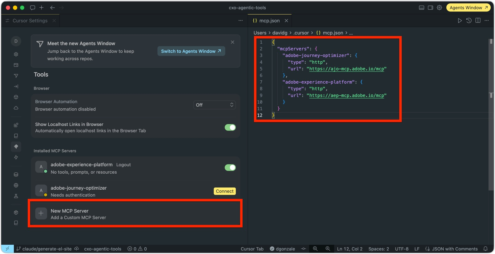
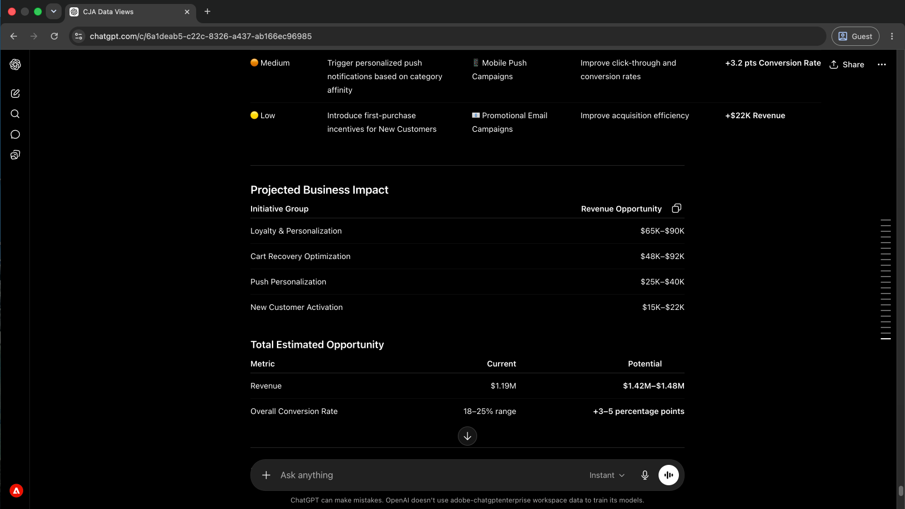
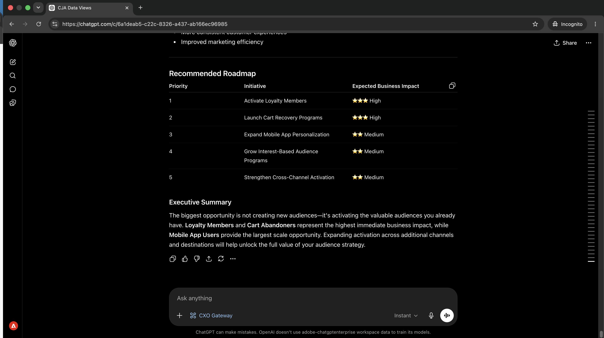
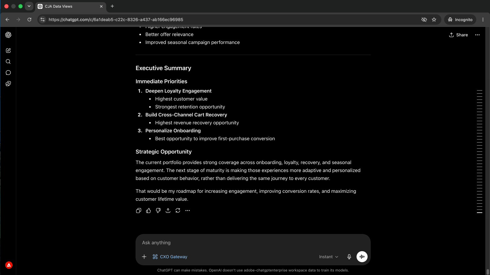
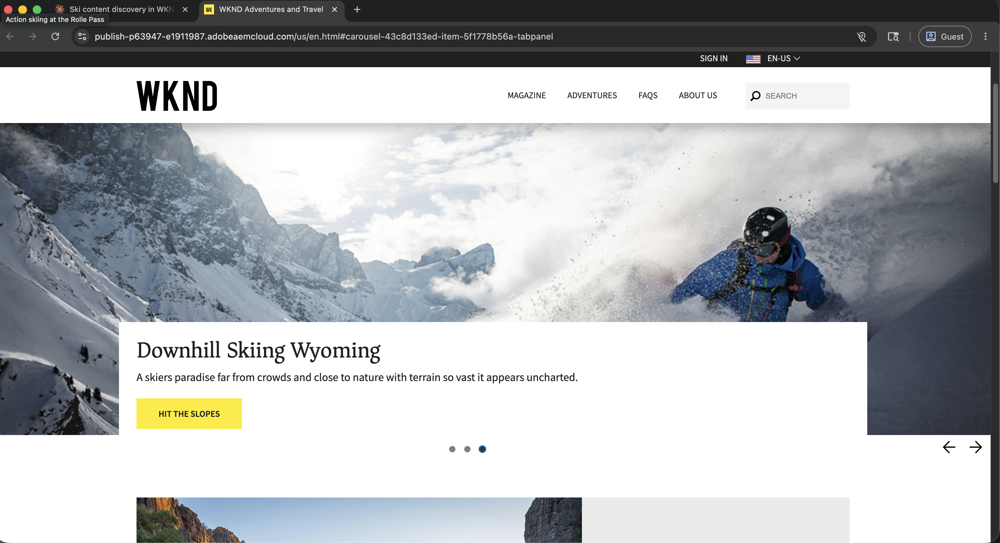
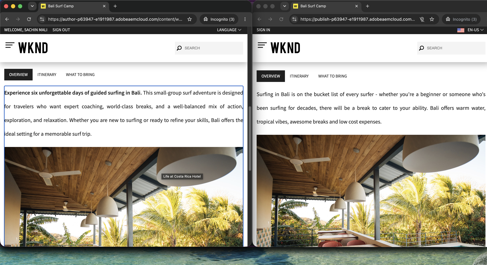

# Servidores MCP

<!-- last-modified: 2026-06-11 -->

>[!VIDEO](https://video.tv.adobe.com/v/3491325/?captions=spa&learn=on&enablevpops)

Los servidores MCP de Adobe proporcionan a cualquier cliente de IA compatible acceso directo y controlado a los datos y flujos de trabajo de Adobe. Conéctese una vez y podrá consultar el rendimiento de la campaña, activar audiencias, revisar recorridos, administrar contenido y mucho más, todo en un lenguaje sencillo, sin salir de su entorno de IA. Debido a que los servidores MCP se encuentran entre su cliente de IA y los sistemas subyacentes de Adobe, obtiene flexibilidad en lenguaje natural mientras los controles de acceso y la gobernanza de datos de su organización permanecen vigentes.

Los servidores MCP de Adobe siguen el estándar [Model Context Protocol](https://modelcontextprotocol.io/docs/getting-started/intro) abierto. Cualquier cliente de IA compatible con MCP se conecta a cualquier servidor MCP de Adobe.

## CX Coworker Gateway {#cx-coworker-gateway}

>[!CONTEXTUALHELP]
>id="cx-enterprise-agentic-tools_mcp_servers_cx-enterprise"
>title="CX Coworker Gateway"
>abstract="Sus aplicaciones de CX Enterprise, accesibles a través de un único punto final MCP. Pregunte, analice y tome medidas en lenguaje sencillo de sus clientes de IA."
>additional-url="https://experienceleague.adobe.com/es/docs/experience-cloud-ai/experience-cloud-ai/mcp/overview" text="Documentación de CX Coworker Gateway"


Seleccione una aplicación para ver el punto de conexión y las funcionalidades.

>[!BEGINTABS]

>[!TAB Puerta de enlace de CX Coworker]

**Un extremo. Varias aplicaciones empresariales de CX.**

Conéctese una vez y su cliente de IA tendrá acceso a las aplicaciones de CX Enterprise en función de las licencias de su organización. Para habilitar su organización, envíe un correo electrónico a [cx-coworker-gateway-support@adobe.com](mailto:cx-coworker-gateway-support@adobe.com) para solicitar acceso.

```
https://cx-coworker-gateway.adobe.io/mcp
```

| aplicación empresarial de CX | Lo que puede hacer | Se requiere un derecho adicional |
| --- | --- | --- |
| [Adobe Analytics](https://experienceleague.adobe.com/es/docs/experience-cloud-ai/experience-cloud-ai/mcp/mcp-product-tools/analytics-mcp) | Detección de grupos de informes, creación de segmentos y creación de espacios de trabajo | No |
| Campaign Classic | Detección de instancias de Campaign, exploración de esquemas, ejecución de consultas, control de flujo de trabajo y ejecución de SOAP/JS | Sí |
| [Adobe Experience Platform](https://experienceleague.adobe.com/es/docs/experience-cloud-ai/experience-cloud-ai/mcp/mcp-product-tools/aep-mcp) | Detección de conjuntos de datos, exploración de esquemas y administración de zonas protegidas | No |
| Experimentación | Informes de experimentos A/B, MVT y MAB, métricas, perspectivas, oportunidades y planificación de tamaño de muestra | No |
| GenStudio for Performance Marketing | Acceso a datos de rendimiento de publicidad y perspectivas creativas | Sí |
| [Adobe Journey Optimizer](https://experienceleague.adobe.com/es/docs/experience-cloud-ai/experience-cloud-ai/mcp/mcp-product-tools/ajo-mcp) | Revisar recorridos, campañas y configuraciones de canal | No |
| Adobe Journey Optimizer B2B edition | Administre recorridos B2B, programas de cuenta, grupos de compra y personalización | No |
| [Adobe Target](https://experienceleague.adobe.com/es/docs/target/using/mcp/target-mcp) | Revise actividades, ofertas, audiencias, mboxes, informes de rendimiento y direcciones URL de vista previa | [Sí](https://experienceleague.adobe.com/es/docs/target/using/mcp/target-mcp-get-started#mcp-security) |
| [Customer Journey Analytics](https://experienceleague.adobe.com/es/docs/experience-cloud-ai/experience-cloud-ai/mcp/mcp-product-tools/cja-mcp) | Consulte informes, descubra vistas de datos y cree espacios de trabajo | No |
| [Marketo Engage](https://experienceleague.adobe.com/es/docs/marketo-developer/marketo/mcp-server) | Administrar programas, campañas, posibles clientes, listas inteligentes, correos electrónicos y formularios | [Sí](https://experienceleague.adobe.com/es/docs/marketo-developer/marketo/mcp-server#get-marketo-credentials) |
| [Real-Time CDP](https://experienceleague.adobe.com/es/docs/experience-cloud-ai/experience-cloud-ai/mcp/mcp-product-tools/rtcdp-mcp) | Comprobar el estado de activación de audiencia, el estado de destino y el estado del flujo de datos | No |

Para obtener toda la documentación, consulte [CX Coworker Gateway](https://experienceleague.adobe.com/es/docs/experience-cloud-ai/experience-cloud-ai/mcp/overview).

>[!NOTE]
>
>El acceso a la pasarela se basa en las licencias de la aplicación CX Enterprise existentes de su organización y en los permisos del usuario en Adobe Admin Console. No se requiere una licencia de colaborador de CX: necesita licencias activas para al menos una de las aplicaciones de CX Enterprise detrás de la puerta de enlace. Para habilitar CX Coworker Gateway para su organización, envíe un correo electrónico a [cx-coworker-gateway-support@adobe.com](mailto:cx-coworker-gateway-support@adobe.com).

>[!TAB Experience Manager]

Adobe Experience Manager tiene varios servidores MCP para diferentes flujos de trabajo.

| Servidor MCP | Punto de conexión | Lo que puede hacer |
| --- | --- | --- |
| [AEM Cloud Manager](https://experienceleague.adobe.com/es/docs/experience-manager-learn/cloud-service/ai/mcp-servers/cloud-manager) | `https://mcp.adobeaemcloud.com/adobe/mcp/cloudmanager` | Administrar programas, entornos, canalizaciones y repositorios |
| [Contenido de AEM](https://experienceleague.adobe.com/es/docs/experience-manager-cloud-service/content/ai-in-aem/using-mcp-with-aem-as-a-cloud-service) | `https://mcp.adobeaemcloud.com/adobe/mcp/content` | Administrar páginas, fragmentos de contenido, recursos e inicios |
| [Contenido de AEM (solo lectura)](https://experienceleague.adobe.com/es/docs/experience-manager-cloud-service/content/ai-in-aem/using-mcp-with-aem-as-a-cloud-service) | `https://mcp.adobeaemcloud.com/adobe/mcp/content-readonly` | Descubra y consulte páginas, fragmentos de contenido e inicios sin acceso de escritura |
| [Gobernanza de AEM Experience](https://experienceleague.adobe.com/es/docs/experience-manager-learn/cloud-service/ai/mcp-servers/experience-governance-mcp-server) | `https://mcp.adobeaemcloud.com/adobe/mcp/experience-governance` | Evaluar el contenido y las imágenes en función de las directrices de marca y las reglas de conformidad |

>[!NOTE]
>
>El acceso a cada entorno de AEM depende de las autorizaciones de AEM Cloud Service de su organización y de los permisos del usuario en ese entorno.

>[!TAB Experience Platform]

| Servidor MCP | Punto de conexión | Lo que puede hacer |
| --- | --- | --- |
| Adobe Marketing Agent | `https://aep-ai-ama.adobe.io/mcp` | Organice el análisis de audiencias, los diagnósticos de AEP y la creación de recorridos B2B de AJO en todas las aplicaciones de AEP |

>[!NOTE]
>
>El acceso depende de los derechos de Adobe Experience Platform de su organización y de los permisos del usuario.

>[!TAB Target]

El MCP de Adobe Target está en versión de beta pública. Todas las herramientas disponibles actualmente son de solo lectura. Las herramientas de escritura están planificadas para su disponibilidad general.

| Servidor MCP | Punto de conexión | Lo que puede hacer |
| --- | --- | --- |
| [Adobe Target](https://experienceleague.adobe.com/es/docs/target/using/mcp/target-mcp) | `https://targetmcp.adobe.io/mcp` | Revise actividades, ofertas, audiencias, mboxes, informes de rendimiento y direcciones URL de vista previa |

>[!NOTE]
>
>El acceso depende de los derechos de Adobe Target y de los permisos del usuario.

>[!TAB Workfront]

| Servidor MCP | Punto de conexión | Lo que puede hacer |
| --- | --- | --- |
| [Adobe Workfront](https://experienceleague.adobe.com/es/docs/workfront/using/basics/workfront-mcp-server/workfront-mcp-server-overview) | `https://mcp.prod.us-west-2.aws.wfk8s.com/mcp/v1/workfront` | Administrar trabajo, proyectos, registros de planificación, perspectivas y aprobaciones de contenido |

>[!NOTE]
>
>El acceso depende de las licencias de Adobe Workfront y de los permisos del usuario.

>[!ENDTABS]

## Conexión a su cliente de IA

La mayoría de los servidores MCP de Adobe utilizan OAuth con Adobe Identity Management Service (IMS). Seleccione la organización IMS correcta cuando se le solicite. La elección del incorrecto es la fuente más común de errores de autenticación.


Los pasos siguientes utilizan el punto final CX Coworker Gateway como ejemplo. El mismo proceso se aplica a cualquier servidor MCP de Adobe: cambie la URL del punto de conexión por el servidor al que desee conectarse.

>[!BEGINTABS]

>[!TAB Claude.ai]

### : usar un conector administrado

Vaya al [Registro de Adobe AI](https://developer.adobe.com/ai-registry/?type=connector) y busque su aplicación de Adobe. Si aparece un conector Claude (por ejemplo, el [conector Adobe Experience Manager](https://developer.adobe.com/ai-registry/#/connectors/adobe-experience-manager-connector)), siga sus instrucciones de configuración en lugar de los pasos siguientes.

### Conexión mediante un conector personalizado

Claude.ai admite servidores MCP remotos a través de conectores personalizados en la configuración de la cuenta.

1. Vaya a **Configuración > Integraciones**.
2. Haga clic en **Agregar conector personalizado**.
3. Escriba el extremo del servidor como dirección URL (por ejemplo, `https://cx-coworker-gateway.adobe.io/mcp` para la puerta de enlace de CX Coworker) y un nombre para mostrar de su elección.
4. Haz clic en **Conectar** e inicia sesión con tu Adobe ID. Seleccione la organización IMS correcta.

Configuración completa: [Documentación de conectores personalizados Claude.ai](https://support.claude.com/en/articles/11175166-get-started-with-custom-connectors-using-remote-mcp)

>[!TAB Código Claude]

### Uso de la CLI

Ejecute `claude mcp add` para registrar un servidor MCP de Adobe. Reemplace el nombre y la dirección URL del servidor por los valores del servidor al que desea conectarse. Este ejemplo utiliza CX Coworker Gateway:

```bash
claude mcp add --transport http adobe-cx-coworker-gateway https://cx-coworker-gateway.adobe.io/mcp
```

### Edite el archivo de configuración

Agregue el servidor a `~/.claude.json` (global) o `.mcp.json` en la raíz del proyecto (nivel de proyecto). Reemplace la clave y la dirección URL por los valores del servidor al que desea conectarse:

```json
{
  "mcpServers": {
    "adobe-cx-coworker-gateway": {
      "type": "http",
      "url": "https://cx-coworker-gateway.adobe.io/mcp"
    }
  }
}
```

Los servidores MCP de Adobe utilizan OAuth. Claude Code le pedirá que se autentique con su Adobe ID la primera vez que llame a una herramienta. Seleccione la organización IMS correcta cuando se le solicite.

Configuración completa: [Documentación del MCP con código Claude](https://docs.anthropic.com/en/docs/claude-code/mcp)

>[!TAB Cursor]

Agregue un servidor MCP de Adobe al archivo de configuración del cursor `mcp.json` y, a continuación, conéctese mediante **Configuración > MCP**. Reemplace la clave y la dirección URL por los valores del servidor al que desea conectarse. Este ejemplo utiliza CX Coworker Gateway:

- **Globales (todos los proyectos):** `~/.cursor/mcp.json`
- **Nivel de proyecto:** `.cursor/mcp.json` en la raíz del proyecto

```json
{
  "mcpServers": {
    "adobe-cx-coworker-gateway": {
      "type": "http",
      "url": "https://cx-coworker-gateway.adobe.io/mcp"
    }
  }
}
```

Una vez agregados, los servidores MCP aparecen en **Servidores MCP instalados** en Configuración del cursor. Seleccione **Conectar** junto a cualquier servidor que muestre **Necesita autenticación** e inicie sesión con su Adobe ID. Seleccione la organización IMS que tiene acceso a la aplicación.



Configuración completa: [Documentación de MCP de cursor](https://cursor.com/docs/mcp)

>[!TAB ChatGPT]

### : usar un conector administrado

Vaya al [Registro de Adobe AI](https://developer.adobe.com/ai-registry/?type=connector) y busque su aplicación de Adobe. Si aparece un conector ChatGPT, siga sus instrucciones de configuración en lugar de los pasos a continuación.

### Conexión mediante un servidor MCP remoto

ChatGPT admite servidores MCP remotos a través del [Modo de desarrollador](https://developers.openai.com/api/docs/guides/developer-mode), disponible en los planes Pro, Plus, Business, Enterprise y Education.

1. Habilitar el modo de desarrollador en **Configuración de ChatGPT**.
2. Vaya a **Configuración > Integraciones**.
3. Haga clic en **Agregar conector personalizado** y elija **Servidor MCP remoto**.
4. Escriba el extremo del servidor como dirección URL (por ejemplo, `https://cx-coworker-gateway.adobe.io/mcp` para la puerta de enlace de CX Coworker) y un nombre para mostrar de su elección.
5. Establezca la autenticación en **OAuth**.
6. Haz clic en **Conectar** e inicia sesión con tu Adobe ID. Seleccione la organización IMS correcta.

Configuración completa: [Documentación de MCP de ChatGPT](https://developers.openai.com/api/docs/guides/tools-connectors-mcp)

>[!TAB CLI de códice OpenAI]

OpenAI Codex CLI admite servidores MCP remotos a través de la configuración TOML.

**Ubicaciones de archivos de configuración:**

- **Nivel de usuario (todos los proyectos):** `~/.codex/config.toml`
- **Ámbito del proyecto:** `.codex/config.toml` en la raíz del proyecto

Reemplace el nombre de sección y la dirección URL por los valores del servidor al que desea conectarse. Este ejemplo utiliza CX Coworker Gateway:

```toml
[mcp_servers.adobe-cx-coworker-gateway]
url = "https://cx-coworker-gateway.adobe.io/mcp"
enabled = true
```

Los servidores MCP de Adobe utilizan OAuth. Codex CLI gestiona el flujo de OAuth automáticamente la primera vez que se utiliza. Seleccione la organización IMS correcta cuando se le solicite.

Configuración completa: [Documentación MCP de OpenAI Codex CLI](https://developers.openai.com/codex/mcp)

>[!TAB Copilot Studio]

Microsoft Copilot Studio se conecta a servidores MCP remotos mediante el asistente de incorporación de MCP, que crea automáticamente un conector personalizado de Power Platform.

1. Abra su agente en Copilot Studio.
2. Vaya a la página **Herramientas**.
3. Seleccione **Agregar una herramienta > Nueva herramienta > Protocolo de contexto de modelo**.
4. En el Asistente para la incorporación de MCP, introduzca los detalles del servidor. Por ejemplo, para CX Coworker Gateway:
   - **Nombre del servidor:** `CX Coworker Gateway`
   - **URL del servidor:** `https://cx-coworker-gateway.adobe.io/mcp`
5. Establezca la autenticación en **OAuth 2.0** y configúrelo con sus URL de autorización y token de Adobe IMS.
6. Seleccione **Crear** y después **Agregar al agente**.

>[!NOTE]
>
>Las conexiones de servidor MCP en Copilot Studio pasan por Power Platform. Se aplican las políticas de prevención de pérdida de datos (DLP) de su organización.

Configuración completa: [Documentación de Copilot Studio MCP](https://learn.microsoft.com/microsoft-copilot-studio/mcp-add-existing-server-to-agent)

>[!ENDTABS]

## Servidores MCP en acción

Vea cómo funciona CX Coworker Gateway en problemas empresariales reales. Cada tutorial parte de un auténtico desafío operativo y muestra cómo un cliente de IA lo resuelve en lenguaje sencillo, sin cambiar de herramienta ni escribir código.

<!--
CARDS

* ../use-cases/analyze-campaign-performance.md
  {title = Campaign insights without reports}
  {description = Ask performance questions in plain language and get answers from Customer Journey Analytics, without building a single report.}
  {cta = Surface campaign insights}

* ../use-cases/query-audiences.md
  {title = Audience activation at a glance}
  {description = See which audiences are live, where they are flowing, and whether destinations are healthy, without navigating Real-Time CDP.}
  {cta = Check audience activation}

* ../use-cases/manage-ajo-journeys.md
  {title = Catch journey issues early}
  {description = Monitor active journeys and surface operational issues before they reach your audience.}
  {cta = Monitor your journeys}

* ../use-cases/manage-aem-content.md
  {title = Ship content updates faster}
  {description = Find, update, and publish AEM pages and content fragments faster, without switching to the AEM interface.}
  {cta = Ship content faster}

* ../use-cases/optimize-content-with-performance-data.md
  {title = Close content performance gaps}
  {description = Surface conversion gaps in CJA, trace them to underperforming content in AEM, and apply the fix in a single AI session.}
  {cta = Close performance gaps}
-->

<!-- START CARDS HTML - DO NOT MODIFY BY HAND -->
<div class="columns">
    <div class="column is-half-tablet is-half-desktop is-one-third-widescreen" aria-label="Campaign insights without reports">
        <div class="card" style="height: 100%; display: flex; flex-direction: column; height: 100%;">
            <div class="card-image">
                <figure class="image x-is-16by9">
                    <a href="../use-cases/analyze-campaign-performance.md" title="Perspectivas de campaña sin informes">
                        
                    </a>
                </figure>
            </div>
            <div class="card-content is-padded-small" style="display: flex; flex-direction: column; flex-grow: 1; justify-content: space-between;">
                <div class="top-card-content">
                    <p class="headline is-size-6 has-text-weight-bold">
                        <a href="../use-cases/analyze-campaign-performance.md" title="Perspectivas de campaña sin informes">Perspectivas de campaña sin informes</a>
                    </p>
                    <p class="is-size-6">Haga preguntas de rendimiento en lenguaje sencillo y obtenga respuestas de Customer Journey Analytics, sin crear un solo informe.</p>
                </div>
                <a href="../use-cases/analyze-campaign-performance.md" class="spectrum-Button spectrum-Button--outline spectrum-Button--primary spectrum-Button--sizeM" style="align-self: flex-start; margin-top: 1rem;">
                    <span class="spectrum-Button-label has-no-wrap has-text-weight-bold">Perspectivas de la campaña de Surface</span>
                
            </div>
        </div>
    </div>
    <div class="column is-half-tablet is-half-desktop is-one-third-widescreen" aria-label="Audience activation at a glance">
        <div class="card" style="height: 100%; display: flex; flex-direction: column; height: 100%;">
            <div class="card-image">
                <figure class="image x-is-16by9">
                    <a href="../use-cases/query-audiences.md" title="Generalidades de Audience activation">
                        
                    </a>
                </figure>
            </div>
            <div class="card-content is-padded-small" style="display: flex; flex-direction: column; flex-grow: 1; justify-content: space-between;">
                <div class="top-card-content">
                    <p class="headline is-size-6 has-text-weight-bold">
                        <a href="../use-cases/query-audiences.md" title="Generalidades de Audience activation">Generalidades de activación de audiencia</a>
                    </p>
                    <p class="is-size-6">Vea qué audiencias están activas, a dónde fluyen y si los destinos están en buen estado, sin navegar por Real-Time CDP.</p>
                </div>
                <a href="../use-cases/query-audiences.md" class="spectrum-Button spectrum-Button--outline spectrum-Button--primary spectrum-Button--sizeM" style="align-self: flex-start; margin-top: 1rem;">
                    <span class="spectrum-Button-label has-no-wrap has-text-weight-bold">Comprobar activación de audiencia</span>
                
            </div>
        </div>
    </div>
    <div class="column is-half-tablet is-half-desktop is-one-third-widescreen" aria-label="Catch journey issues early">
        <div class="card" style="height: 100%; display: flex; flex-direction: column; height: 100%;">
            <div class="card-image">
                <figure class="image x-is-16by9">
                    <a href="../use-cases/manage-ajo-journeys.md" title="Detectar problemas de recorrido antes">
                        
                    </a>
                </figure>
            </div>
            <div class="card-content is-padded-small" style="display: flex; flex-direction: column; flex-grow: 1; justify-content: space-between;">
                <div class="top-card-content">
                    <p class="headline is-size-6 has-text-weight-bold">
                        <a href="../use-cases/manage-ajo-journeys.md" title="Detectar problemas de recorrido antes">Detectar problemas de recorrido antes</a>
                    </p>
                    <p class="is-size-6">Supervise los recorridos activos y los problemas operativos antes de que lleguen a su audiencia.</p>
                </div>
                <a href="../use-cases/manage-ajo-journeys.md" class="spectrum-Button spectrum-Button--outline spectrum-Button--primary spectrum-Button--sizeM" style="align-self: flex-start; margin-top: 1rem;">
                    <span class="spectrum-Button-label has-no-wrap has-text-weight-bold">Supervise sus recorridos</span>
                
            </div>
        </div>
    </div>
    <div class="column is-half-tablet is-half-desktop is-one-third-widescreen" aria-label="Ship content updates faster">
        <div class="card" style="height: 100%; display: flex; flex-direction: column; height: 100%;">
            <div class="card-image">
                <figure class="image x-is-16by9">
                    <a href="../use-cases/manage-aem-content.md" title="Envío de actualizaciones de contenido más rápido">
                        
                    </a>
                </figure>
            </div>
            <div class="card-content is-padded-small" style="display: flex; flex-direction: column; flex-grow: 1; justify-content: space-between;">
                <div class="top-card-content">
                    <p class="headline is-size-6 has-text-weight-bold">
                        <a href="../use-cases/manage-aem-content.md" title="Envío de actualizaciones de contenido más rápido">Enviar actualizaciones de contenido más rápido</a>
                    </p>
                    <p class="is-size-6">Busque, actualice y publique páginas de AEM y fragmentos de contenido más rápido, sin cambiar a la interfaz de AEM.</p>
                </div>
                <a href="../use-cases/manage-aem-content.md" class="spectrum-Button spectrum-Button--outline spectrum-Button--primary spectrum-Button--sizeM" style="align-self: flex-start; margin-top: 1rem;">
                    <span class="spectrum-Button-label has-no-wrap has-text-weight-bold">Enviar contenido más rápido</span>
                
            </div>
        </div>
    </div>
    <div class="column is-half-tablet is-half-desktop is-one-third-widescreen" aria-label="Close content performance gaps">
        <div class="card" style="height: 100%; display: flex; flex-direction: column; height: 100%;">
            <div class="card-image">
                <figure class="image x-is-16by9">
                    <a href="../use-cases/optimize-content-with-performance-data.md" title="Cerrar brechas de rendimiento de contenido">
                        
                    </a>
                </figure>
            </div>
            <div class="card-content is-padded-small" style="display: flex; flex-direction: column; flex-grow: 1; justify-content: space-between;">
                <div class="top-card-content">
                    <p class="headline is-size-6 has-text-weight-bold">
                        <a href="../use-cases/optimize-content-with-performance-data.md" title="Cerrar brechas de rendimiento de contenido">Cerrar brechas de rendimiento de contenido</a>
                    </p>
                    <p class="is-size-6">Elimine los huecos de conversión en CJA, rastree el contenido con bajo rendimiento en AEM y aplique la corrección en una sola sesión de IA.</p>
                </div>
                <a href="../use-cases/optimize-content-with-performance-data.md" class="spectrum-Button spectrum-Button--outline spectrum-Button--primary spectrum-Button--sizeM" style="align-self: flex-start; margin-top: 1rem;">
                    <span class="spectrum-Button-label has-no-wrap has-text-weight-bold">Cerrar brechas de rendimiento</span>
                
            </div>
        </div>
    </div>
</div>
<!-- END CARDS HTML - DO NOT MODIFY BY HAND -->

## ¿Necesita más ayuda?

Las conexiones MCP implican autenticación, selección de la organización y permisos de nivel de aplicación. Si algo no funciona como se espera, estos pasos cubren las causas más comunes.

+++Cambio de organizaciones de Adobe

Si el usuario de Adobe pertenece a varias organizaciones de IMS y ve herramientas o datos para la incorrecta, desconecte el servidor MCP, cierre la sesión de Adobe en el explorador y vuelva a conectarse. Se le pedirá que elija una organización durante el inicio de sesión.

Un servidor MCP de Adobe solo se puede autenticar en una organización IMS a la vez, aunque su cuenta de usuario tenga acceso a más de una.

+++

+++Especificar una zona protegida, un grupo de informes, un entorno u otro recurso de sesión

Algunos servidores MCP de Adobe requieren que especifique un recurso para que puedan devolver resultados. Según la aplicación, puede ser una zona protegida, un programa, un entorno, un grupo de informes o una vista de datos.

Si no está seguro de a qué recursos tiene acceso, pregunte al cliente de IA. Por ejemplo: &quot;Enumerar los entornos limitados disponibles&quot; o &quot;¿A qué grupos de informes tengo acceso?&quot; Los servidores MCP de Adobe suelen devolver una lista completa de los recursos disponibles para el usuario.

Una vez configurado un recurso de sesión, puede cambiarlo en cualquier momento indicando al cliente de IA cuál utilizar.

+++

+++Permisos y errores de acceso

Los clientes de IA actúan en nombre de su cuenta de usuario de Adobe mediante OAuth. Los mismos permisos y controles de acceso que se aplican cuando se inicia sesión en una aplicación de Adobe se aplican cuando se utiliza un servidor MCP.

Si una acción falla o no devuelve resultados, compruebe que el usuario tenga los permisos necesarios en Adobe Admin Console y en la aplicación CX Enterprise correspondiente. Póngase en contacto con el administrador del sistema de Adobe si necesita ajustar el acceso.

+++

+++Volver a autenticarse después de una sesión perdida

Los servidores MCP de Adobe utilizan OAuth para autenticar la cuenta de usuario de Adobe. Si se pierde el estado de autenticación, no se realizarán más llamadas de herramienta hasta que se vuelva a autenticar.

Para volver a autenticar: abra la configuración del servidor MCP del cliente de IA, seleccione la entrada del servidor MCP de Adobe y vuelva a conectarse. Se le pedirá que vuelva a iniciar sesión con su Adobe ID.

+++
