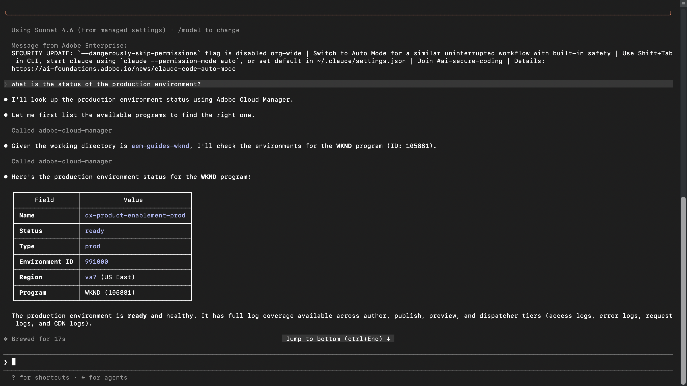
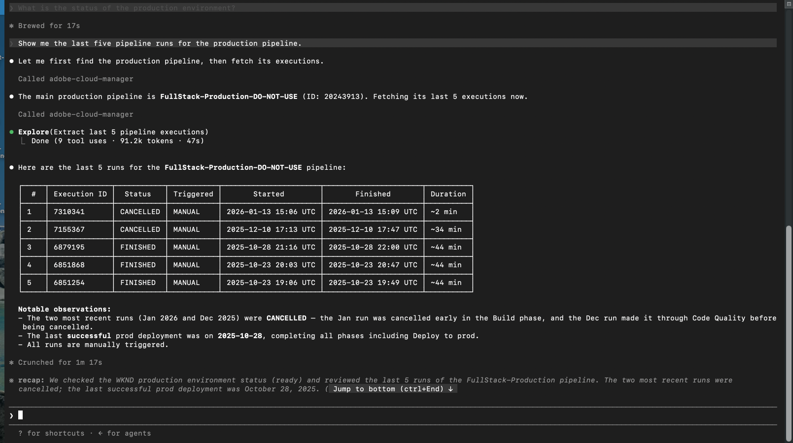
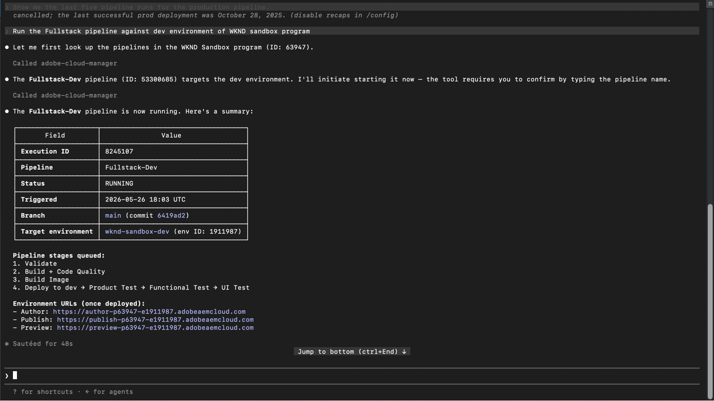
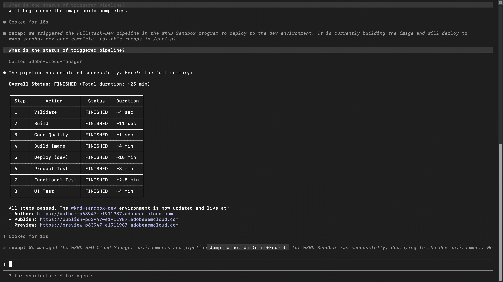

# Implementar en AEM as a Cloud Service con confianza

<!-- last-modified: 2026-05-21 -->

>[!VIDEO](https://video.tv.adobe.com/v/3480340/?learn=on&enablevpops)

La confianza de la implementación proviene de saber que su entorno está en buen estado antes de realizar la push. Este tutorial muestra cómo comprobar el estado del entorno de AEM, revisar el historial de canalización y las implementaciones de déclencheur desde un cliente de IA mediante el servidor MCP de AEM Cloud Manager, de modo que los equipos puedan moverse rápidamente sin perder visibilidad.

| Detalles del escenario | |
| --- | --- |
| Aplicaciones empresariales de CX | [Adobe Experience Manager Cloud Manager](https://experienceleague.adobe.com/en/docs/experience-manager-cloud-service/content/implementing/using-cloud-manager/introduction-to-cloud-manager) |
| Herramientas agénticas | [Servidor MCP de AEM Cloud Manager](https://experienceleague.adobe.com/es/docs/experience-manager-learn/cloud-service/ai/mcp-servers/cloud-manager) |
| Público | Desarrolladores, DevOps, equipos de operaciones |
| Requisito previo | Cliente de IA compatible con MCP, acceso a AEM Cloud Manager |

Cada paso muestra un mensaje representativo y un ejemplo de respuesta de IA. A continuación hay **más indicaciones para probar** sección para realizar exploraciones adicionales en la misma sesión.

## Antes de empezar

>[!BEGINTABS]

>[!TAB Código Claude]

Vaya primero al directorio del proyecto y, a continuación, añada Cloud Manager MCP Server mediante la CLI:

```bash
claude mcp add --transport http adobe-cloud-manager https://mcp.adobeaemcloud.com/adobe/mcp/cloudmanager
```

O agréguelo manualmente a `.mcp.json` en la raíz del proyecto:

```json
{
  "mcpServers": {
    "adobe-cloud-manager": {
      "type": "http",
      "url": "https://mcp.adobeaemcloud.com/adobe/mcp/cloudmanager"
    }
  }
}
```

Reinicie Claude Code. Las herramientas de Cloud Manager están disponibles en la próxima sesión.

Configuración completa: [Documentación del MCP con código Claude](https://docs.anthropic.com/en/docs/claude-code/mcp)

>[!TAB Cursor]

Agregue el servidor MCP de Cloud Manager a `~/.cursor/mcp.json` (global) o `.cursor/mcp.json` en la raíz del proyecto:

```json
{
  "mcpServers": {
    "adobe-cloud-manager": {
      "type": "http",
      "url": "https://mcp.adobeaemcloud.com/adobe/mcp/cloudmanager"
    }
  }
}
```

Abra **Configuración > MCP**, seleccione **Conectar** junto al servidor e inicie sesión con su Adobe ID.

Configuración completa: [Documentación de MCP de cursor](https://cursor.com/docs/mcp)

>[!TAB Copiloto de GitHub]

Agregue el servidor MCP de Cloud Manager a `.vscode/mcp.json` en la raíz del proyecto:

```json
{
  "servers": {
    "adobe-cloud-manager": {
      "type": "http",
      "url": "https://mcp.adobeaemcloud.com/adobe/mcp/cloudmanager"
    }
  }
}
```

Nota: el código VS usa `"servers"` como clave de nivel superior, no `"mcpServers"`.

Abra el panel **Chat de copiloto de GitHub**, cambie a **Modo de agente** y seleccione **Conectar** junto al servidor. Las herramientas de MCP solo están disponibles en el modo Agente.

Configuración completa: [Documentación de servidores MCP con código VS](https://code.visualstudio.com/docs/copilot/customization/mcp-servers)

>[!TAB Otros clientes de IA]

¿Utiliza otro entorno compatible con MCP? Conéctese al servidor MCP de Cloud Manager mediante este extremo:

```
https://mcp.adobeaemcloud.com/adobe/mcp/cloudmanager
```

Instrucciones de configuración completas para todos los clientes admitidos: [Conéctese a su cliente de IA](../tools/mcp-servers.md)

>[!ENDTABS]

>[!NOTE]
>
>Inicie sesión con su Adobe ID cuando se le solicite y seleccione la organización de IMS vinculada a su programa de AEM as a Cloud Service. Los permisos se aplican en el nivel de Cloud Manager. Su cliente de IA solo puede realizar operaciones para las que su cuenta está autorizada.
>
>En la primera conexión, su cliente de IA puede solicitarle que confirme su organización o programa de AEM. Una vez establecido ese contexto, el servidor MCP lo utiliza para el resto de la sesión.
>
>Algunas herramientas le piden su aprobación antes de ejecutarse. Revisar la acción propuesta y aprobarla o rechazarla. No se realiza ninguna acción sin su confirmación.

## Paso 1: Comprobar el estado del entorno

Antes de iniciar una versión, confirme que los entornos están en buen estado y que no hay nada en ejecución de forma activa.

```
What is the status of the production environment?
```

+++Ver una respuesta de ejemplo



+++


## Paso 2: Revisar las ejecuciones de canalización

Revise el historial de canalizaciones reciente para comprender los patrones de implementación y detectar errores antes de que bloqueen su próxima versión.

```
Show me the last five pipeline runs for the production pipeline.
```

+++Ver una respuesta de ejemplo



+++


## Paso 3: Déclencheur de una canalización

Inicie una canalización que se ejecute directamente desde su cliente de IA. El servidor confirma el entorno de destino y solicita la aprobación antes de iniciarse.

```
Run the Fullstack pipeline against dev environment of WKND sandbox program.
```

+++Ver una respuesta de ejemplo



+++


>[!CAUTION]
>
>El cliente de IA le pedirá que confirme el nombre de la canalización antes de activar una ejecución. Introduzca el nombre exacto de la canalización para continuar. Revise cuidadosamente el entorno de destino antes de confirmar, especialmente para las canalizaciones que se implementan en producción.

## Paso 4: Comprobar el estado de la canalización

Después de activar una ejecución, solicite a su cliente de IA una actualización de estado sin cambiar a la interfaz de Cloud Manager.

```
What is the status of the triggered pipeline?
```

+++Ver una respuesta de ejemplo



+++


## Lo que ha conseguido

Utilizó el servidor MCP de AEM Cloud Manager para comprobar el estado del entorno, revisar el historial de la canalización, almacenar en déclencheur una implementación y comprobar su estado, sin abrir la interfaz de Cloud Manager. Al combinar la visibilidad del entorno y el control de la implementación en una sola sesión de IA, los equipos de desarrollo y operaciones pueden responder a los problemas más rápido y mantener su flujo de trabajo dentro de las herramientas que ya utilizan.

## Más cosas que puede lograr

El servidor MCP de Cloud Manager administra mucho más de lo que cubre el tutorial anterior. Expanda un escenario de abajo para ver las indicaciones que puede probar en la misma sesión.

+++Detectar problemas antes de que se publique una versión

Las implementaciones suelen fallar por motivos que eran visibles antes de que se ejecutara la canalización. Estos mensajes le ayudan a confirmar el estado del entorno, comprobar si hay ejecuciones en conflicto y comprobar la alineación de las versiones en todos los entornos antes de confirmar una versión.

**Indicadores**

```
We're about to kick off a production release. Give me a full status check on all environments first.
```

```
Is there anything currently running in the staging pipeline? I don't want to queue on top of an active run.
```

```
Before I promote main branch to production, confirm main was deployed to Dev and all environments are on the same AEM version.
```

```
What repositories are connected to the WKND program?
```

+++

+++Corrija el curso en una implementación que ya está en vuelo

Un déclencheur accidental o una puerta de aprobación estancada pueden derivar en cascada a una canalización bloqueada o a una implementación no deseada. Estas indicaciones le permiten cancelar o avanzar una canalización en ejecución sin cambiar a la interfaz de Cloud Manager.

**Indicadores**

```
The staging pipeline kicked off by mistake. Cancel it before it deploys.
```

```
The release pipeline is waiting at the approval gate. Advance it to continue the deployment.
```

+++

+++Comprender el historial de implementación

Saber cuándo tuvieron éxito las cosas por última vez, cuánto tiempo se ejecutan las canalizaciones y si los patrones están cambiando le ayuda a planificar las versiones y detectar una degradación lenta antes de que se convierta en un incidente. Utilice estos indicadores para extraer ese historial bajo demanda.

**Indicadores**

```
What is the status of the last production pipeline execution? If it failed, explain why.
```

```
When was the last successful deployment to the staging environment?
```

```
Our pipeline times are creeping up. What's the longest run we've had in the last 30 days?
```

+++

+++Vuelva a encauzar una compilación dañada

Cuando falla una canalización, la ruta más rápida para la resolución es comprender exactamente dónde se rompió y por qué. Estos mensajes muestran detalles de errores, historial de cambios y problemas de puerta de calidad para que su equipo pueda diagnosticar y corregir sin explorar manualmente los registros.

**Indicadores**

```
We're seeing a regression on the live site. What changed in production over the last week?
```

```
Which pipelines have failed in the last 7 days, and at what stage did they fail?
```

```
The last pipeline failed at the code quality step. What specific issues need to be fixed before I can retry?
```

```
Pull the step logs for the last failed run. I need to see exactly what the quality gate flagged.
```

+++


## Más información

| Recurso | Qué va a encontrar |
| --- | --- |
| [Documentación de AEM as a Cloud Service](https://experienceleague.adobe.com/es/docs/experience-manager-cloud-service){target="_blank"} | Documentación completa de la aplicación de AEM |
