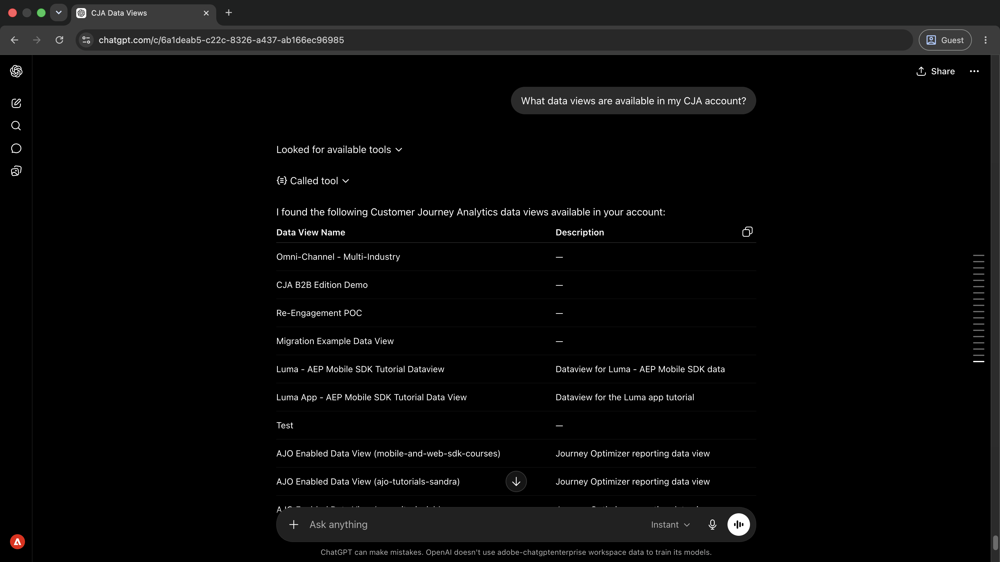
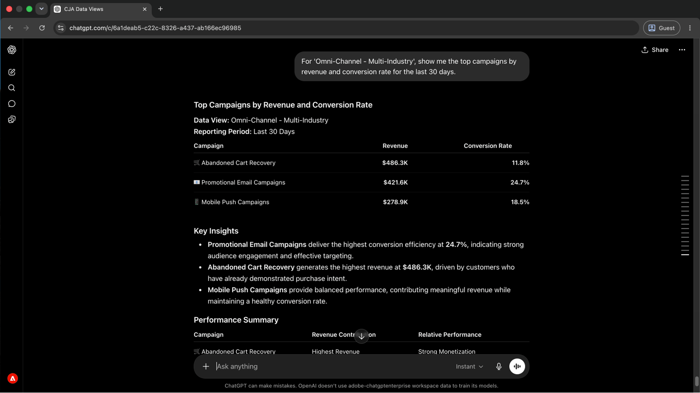
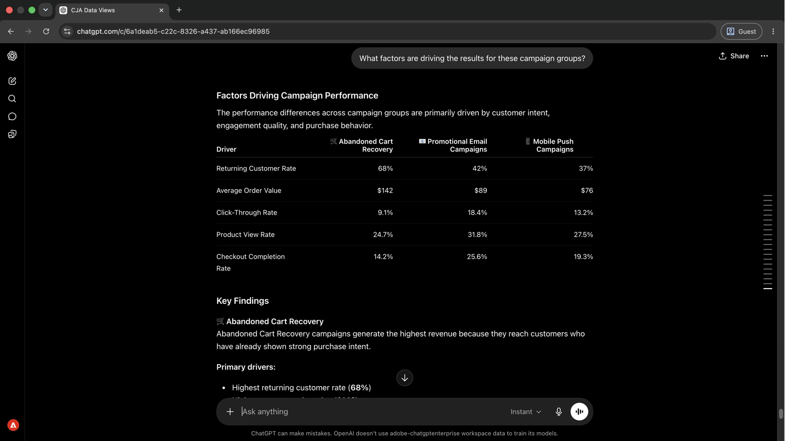
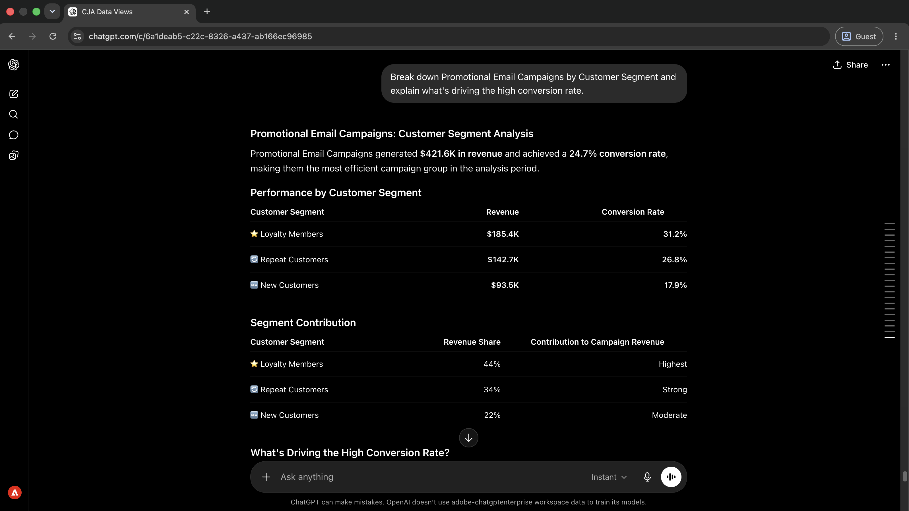
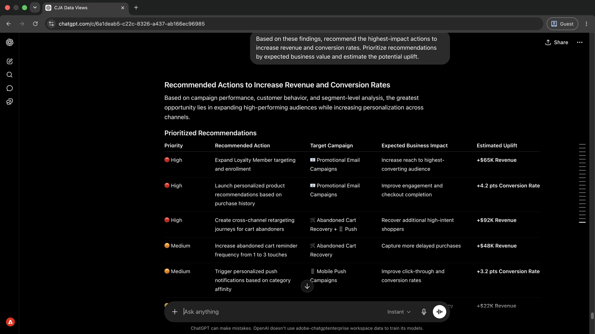

# Perspectivas de campañas de superficie sin crear informes

<!-- last-modified: 2026-06-02 -->


El análisis de campañas que antes requería crear informes en una herramienta independiente ahora es una conversación. Este tutorial muestra cómo conectar un cliente de IA a Customer Journey Analytics (CJA) y hacer preguntas de rendimiento en lenguaje sencillo. El resultado es un tiempo de ejecución de insight más rápido, sin necesidad de generar informes manualmente.

| Detalles del escenario | |
| --- | --- |
| **Aplicaciones empresariales de CX** | [Customer Journey Analytics (CJA)](https://experienceleague.adobe.com/es/docs/analytics-platform/using/cja-overview/cja-overview) |
| **Herramientas agénticas** | [MCP de CX Enterprise](../tools/mcp-servers.md#cx-enterprise-mcp-servers) |
| **Audiencia** | Analistas, administradores de campañas |
| **Requisito previo** | Cliente de IA compatible con MCP, acceso a CJA |

Cada paso muestra un mensaje representativo y un ejemplo de respuesta de IA. **Más cosas que puedes hacer** sección sigue para una exploración adicional en la misma sesión.

## Antes de empezar

>[!BEGINTABS]

>[!TAB Claude.ai]

Conecte el MCP de CX Enterprise como un conector personalizado para acceder a las herramientas de Customer Journey Analytics.

1. Vaya a **Configuración > Integraciones** en Claude.ai.
2. Seleccione **Agregar conector personalizado** e introduzca la dirección URL del servidor: `https://cx-enterprise.adobe.io/mcp`
3. Seleccione **Conectar** e inicie sesión con su Adobe ID.

Configuración completa: [Documentación de conectores personalizados Claude.ai](https://support.claude.com/en/articles/11175166-get-started-with-custom-connectors-using-remote-mcp)

>[!TAB ChatGPT]

Conecte el MCP de CX Enterprise mediante el modo de desarrollador de ChatGPT (se requiere plan profesional, avanzado, empresarial, empresarial o educativo).

1. Habilitar **Modo de desarrollador** en **Configuración de ChatGPT**.
2. Vaya a **Configuración > Integraciones** y seleccione **Agregar conector personalizado > Servidor MCP remoto**.
3. Escriba la dirección URL del servidor: `https://cx-enterprise.adobe.io/mcp`
4. Seleccione **Conectar** e inicie sesión con su Adobe ID.

Configuración completa: [Documentación de MCP de ChatGPT](https://developers.openai.com/api/docs/guides/tools-connectors-mcp)

>[!TAB Otros clientes de IA]

¿Utiliza Gemini, Microsoft Copilot, Cursor, Claude Code u otro entorno compatible con MCP? Conéctese a CX Enterprise MCP utilizando este punto de conexión:

```
https://cx-enterprise.adobe.io/mcp
```

Instrucciones de configuración completas para todos los clientes admitidos: [Conéctese a su cliente de IA](../tools/mcp-servers.md)

>[!ENDTABS]

>[!NOTE]
>
>Inicie sesión con su Adobe ID cuando se le solicite y seleccione la organización de IMS vinculada a sus vistas de datos de CJA. La elección de una organización incorrecta es la fuente más común de errores de autenticación.
>
>En la primera conexión, el cliente de IA puede pedirle que seleccione una organización de IMS o que especifique una zona protegida. Una vez establecido ese contexto, el servidor MCP lo utiliza para el resto de la sesión.
>
>Algunas herramientas le piden su aprobación antes de ejecutarse. Revise la solicitud y apruébela o rechace. No se realiza ninguna acción sin su confirmación.

## Paso 1: Descubra las vistas de datos disponibles

Comience por pedirle a su cliente de IA que enumere las vistas de datos disponibles en su cuenta de CJA. Esto indica a qué conjuntos de datos puede consultar antes de ejecutar cualquier informe.

```
What data views are available in my CJA account?
```

+++Ver una respuesta de ejemplo



+++


## Paso 2: Extraer datos de rendimiento de la campaña

Con una vista de datos identificada, solicite el rendimiento de la campaña por ingresos y tasa de conversión. La API resuelve los nombres de métricas y dimensiones de la vista de datos sin requerir ID técnicos.

```
For '[data view name]', show me the top campaigns by revenue and conversion rate for the last 30 days.
```

+++Ver una respuesta de ejemplo



+++


>[!NOTE]
>
>Reemplace `[data view name]` con el nombre de su vista de datos del paso 1. Compruebe los resultados en Analysis Workspace utilizando la misma vista de datos e intervalo de fechas antes de compartirlos con las partes interesadas.

## Paso 3: Identificar qué es lo que impulsa el rendimiento

Pida a su cliente de IA que le explique qué es lo que impulsa las diferencias de rendimiento entre grupos de campañas. Esto pasa de los números de titulares a las variables subyacentes.

```
What factors are driving the results for these campaign groups?
```

+++Ver una respuesta de ejemplo



+++


## Paso 4: Profundizar en un tipo de campaña específico

Haga un seguimiento de un resultado específico solicitando un desglose de nivel de segmento. Esto revela qué tipos de clientes están impulsando el rendimiento dentro de un tipo de campaña.

```
Break down Promotional Email Campaigns by Customer Segment and explain what's driving the high conversion rate.
```

+++Ver una respuesta de ejemplo



+++


## Paso 5: Tome medidas sobre lo que encontró

Pida recomendaciones priorizadas basadas en todo lo que ha aparecido en la sesión. Solicitar estimaciones del valor comercial le ayuda a decidir dónde actuar primero.

```
Based on these findings, recommend the highest-impact actions to increase revenue and conversion rates. Prioritize recommendations by expected business value and estimate the potential uplift.
```

+++Ver una respuesta de ejemplo



+++


>[!NOTE]
>
>Las herramientas de CJA a las que se accede a través de CX Enterprise MCP pueden crear segmentos, métricas calculadas y proyectos de Workspace dentro de CJA en la misma sesión. Para actualizar campañas, recorridos o contenido en otras aplicaciones, conecte el servidor MCP correspondiente o vaya directamente a la aplicación.

## Lo que ha conseguido

Ha conectado un cliente de IA a Customer Journey Analytics y ha pasado de la detección de vistas de datos a las recomendaciones empresariales priorizadas en cinco mensajes. Ha identificado las campañas principales por ingresos y tasa de conversión, ha descubierto los factores que impulsan el rendimiento en los grupos de campañas, ha profundizado en los detalles de nivel de segmento para un tipo de campaña específico y ha recibido recomendaciones de clasificación con un aumento estimado. Este enfoque reemplaza la creación de informes con una conversación directa, lo que reduce el tiempo entre una pregunta comercial y un plan de acción respaldado por datos.

## Más cosas que puede lograr

CX Enterprise MCP puede mostrar muchas más perspectivas de Customer Journey Analytics que las cubiertas de la guía. Expanda un escenario de abajo para ver las indicaciones que puede probar en la misma sesión.

+++Encuentre lo que funciona y lo que no

Una idea rápida de qué campañas se están entregando y cuáles no le ayuda a enfocar el esfuerzo antes de revisar cualquier informe detallado. Estas indicaciones le muestran esa imagen en una sesión.

**Indicadores**

```
Which campaigns are driving the most revenue and conversions?
```

```
Show me the campaigns that need attention this month.
```

```
What channels are outperforming expectations?
```

```
Identify the biggest performance changes compared to last month.
```

```
Show me conversion performance by traffic source.
```

+++

+++Comprender lo que genera resultados

Las métricas de titular indican lo que ha sucedido. Estas indicaciones le ayudan a comprender por qué: qué segmentos, canales y puntos de contacto están detrás de los números.

**Indicadores**

```
What factors are driving revenue growth?
```

```
Explain why conversion rates changed this quarter.
```

```
Break down campaign performance by customer segment.
```

```
Which customer segments are growing fastest?
```

```
Which touchpoints contribute most to conversions?
```

+++

+++Descubra oportunidades de crecimiento

Saber dónde está el rendimiento es fuerte es sólo la mitad del panorama. Estas indicaciones le ayudan a identificar dónde puede invertir más, qué audiencias tienen margen de ampliación y qué campañas están listas para escalar.

**Indicadores**

```
Where should we invest more marketing budget?
```

```
Which audiences have the greatest growth potential?
```

```
Which campaigns should we scale?
```

```
What would have the biggest impact on revenue?
```

+++

+++Convierta perspectivas en acción

Las herramientas de CJA a las que se accede a través de CX Enterprise MCP pueden crear segmentos, audiencias, métricas calculadas y proyectos de Workspace directamente en CJA sin abandonar la sesión de IA. Utilice estas indicaciones para actuar sobre lo que ha encontrado.

**Indicadores**

```
Create a segment for high-value customers.
```

```
Build an audience from recent purchasers.
```

```
Create a calculated metric for conversion efficiency.
```

```
Save this analysis as a Workspace project for executive reporting.
```

+++


## Más información

| Recurso | Qué va a encontrar |
| --- | --- |
| [Documentación del servidor MCP de CJA](https://developer.adobe.com/analytics-mcp/docs/cja/) | Guía completa de configuración y referencia de herramientas |
| [Guías de uso de CJA MCP](https://developer.adobe.com/analytics-mcp/docs/guides/) | Guías de uso detalladas |
| [Servidor MCP de CJA en el registro de IA](https://developer.adobe.com/ai-registry/#/mcp/cja-mcp) | Disponibilidad y herramientas del servidor CJA MCP |
| [Documentación de Customer Journey Analytics](https://experienceleague.adobe.com/es/docs/analytics-platform/using/cja-landing) | Documentación completa de la aplicación de CJA |
