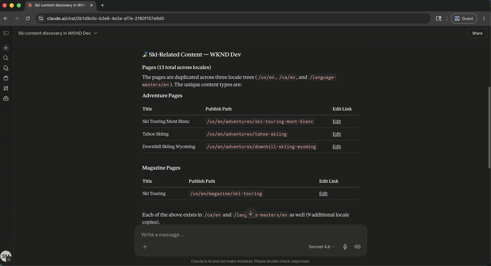
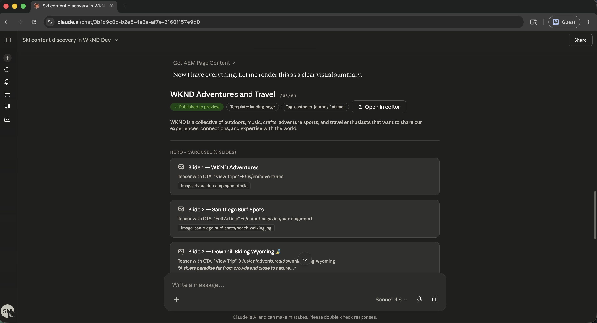
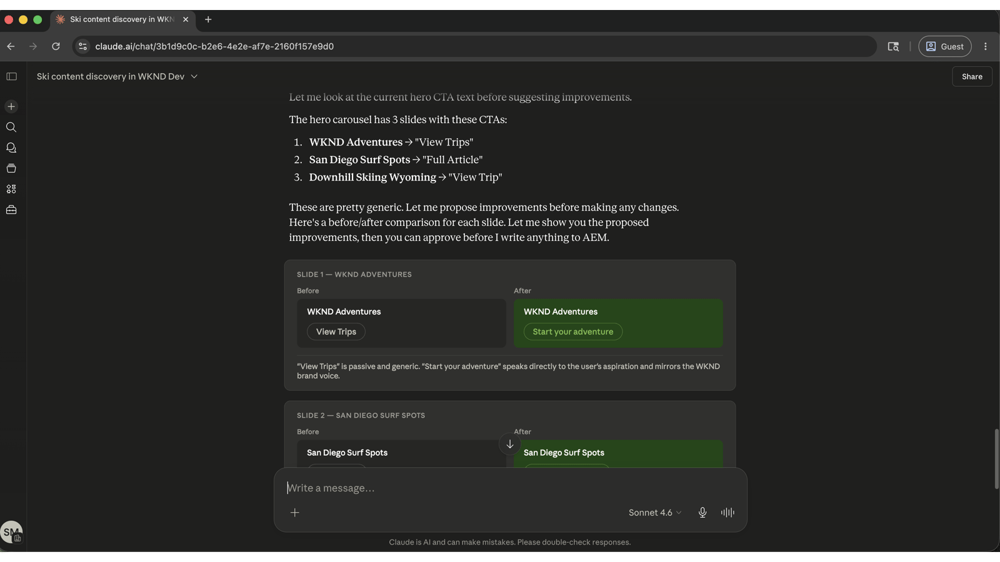
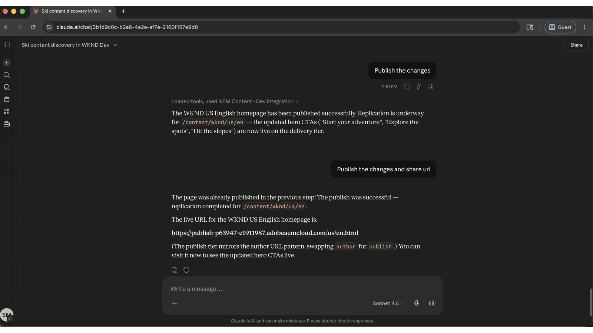

# Mantener el contenido actualizado y enviar actualizaciones más rápido

<!-- last-modified: 2026-05-22 -->


Las operaciones de contenido en Adobe Experience Manager, desde la búsqueda de páginas y la revisión de contenido hasta la realización de actualizaciones y publicaciones, suelen requerir la navegación directa por la interfaz de AEM. Este tutorial muestra cómo gestionar esas operaciones a través de un cliente de IA mediante el servidor MCP de contenido de AEM, de modo que los equipos de contenido puedan moverse más rápido sin cambiar de herramienta según el contexto.

| Detalles del escenario | |
| --- | --- |
| Aplicaciones empresariales de CX | [Adobe Experience Manager as a Cloud Service](https://experienceleague.adobe.com/es/docs/experience-manager-cloud-service/content/overview/introduction) |
| Herramientas agénticas | [Servidor MCP de contenido AEM](https://experienceleague.adobe.com/es/docs/experience-manager-cloud-service/content/ai-in-aem/using-mcp-with-aem-as-a-cloud-service) |
| Público | Administradores de contenido, equipos de marketing |
| Requisito previo | Cliente de IA compatible con MCP, acceso a AEM as a Cloud Service |

Cada paso muestra un mensaje representativo y un ejemplo de respuesta de IA. **Más cosas que puedes hacer** sección sigue para una exploración adicional en la misma sesión.

## Antes de empezar

>[!BEGINTABS]

>[!TAB Claude.ai]

Conecte AEM Content MCP Server como un conector personalizado.

1. Vaya a **Configuración > Integraciones** en Claude.ai.
2. Seleccione **Agregar conector personalizado** e introduzca la dirección URL del servidor: `https://mcp.adobeaemcloud.com/adobe/mcp/content`
3. Seleccione **Conectar** e inicie sesión con su Adobe ID.

Configuración completa: [Documentación de conectores personalizados Claude.ai](https://support.claude.com/en/articles/11175166-get-started-with-custom-connectors-using-remote-mcp)

>[!TAB ChatGPT]

Conecte el servidor MCP de contenido de AEM mediante el modo de desarrollador de ChatGPT (se requiere plan profesional, avanzado, empresarial, o educativo).

1. Habilitar **Modo de desarrollador** en **Configuración de ChatGPT**.
2. Vaya a **Configuración > Integraciones** y seleccione **Agregar conector personalizado > Servidor MCP remoto**.
3. Escriba la dirección URL del servidor: `https://mcp.adobeaemcloud.com/adobe/mcp/content`
4. Seleccione **Conectar** e inicie sesión con su Adobe ID.

Configuración completa: [Documentación de MCP de ChatGPT](https://developers.openai.com/api/docs/guides/tools-connectors-mcp)

>[!TAB Otros clientes de IA]

¿Utiliza Gemini, Microsoft Copilot, Cursor, Claude Code u otro entorno compatible con MCP? Conéctese al servidor MCP de contenido de AEM mediante este extremo:

```
https://mcp.adobeaemcloud.com/adobe/mcp/content
```

Instrucciones de configuración completas para todos los clientes admitidos: [Conéctese a su cliente de IA](../tools/mcp-servers.md)

>[!ENDTABS]

>[!NOTE]
>
>Inicie sesión con su Adobe ID cuando se le solicite y seleccione la organización de IMS vinculada a su entorno de AEM as a Cloud Service. Los permisos se aplican en el nivel de AEM. Su cliente de IA solo puede realizar operaciones para las que su cuenta está autorizada.
>
>Si solo necesita examinar o auditar el contenido sin realizar cambios, use el extremo de servidor de solo lectura: `https://mcp.adobeaemcloud.com/adobe/mcp/content-readonly`. Todas las solicitudes de detección y revisión de esta página funcionan con ambos servidores.
>
>En la primera conexión, su cliente de IA puede solicitarle que confirme su organización o entorno de AEM. Una vez establecido ese contexto, el servidor MCP lo utiliza para el resto de la sesión.
>
>Algunas herramientas le piden su aprobación antes de ejecutarse. Revisar la acción propuesta y aprobarla o rechazarla. No se realiza ningún cambio sin su confirmación.

## Paso 1: Buscar contenido en el entorno de AEM

Comience por pedirle a su cliente de IA que descubra sus entornos de AEM y busque contenido. Puede buscar por tema, palabra clave o tipo de contenido sin conocer las rutas exactas.

```
From WKND Dev environment, find all ski related content.
```

+++Ver una respuesta de ejemplo



+++


## Paso 2: Revisar una página específica

Una vez que haya localizado contenido relevante, pídale a su cliente de IA que le muestre una página específica. Puede hacer referencia a las páginas por nombre o ruta. El servidor MCP resuelve la referencia y devuelve la estructura de contenido.

```
Show me the US English Home Page.
```

+++Ver una respuesta de ejemplo



+++


## Paso 3: Mejorar el contenido

Con el contenido de la página a la vista, pida a su cliente de IA que le sugiera o aplique mejoras. La IA puede proponer cambios de copia basados en lo que dice la página actualmente y pedir confirmación antes de escribir nada.

```
Improve the Hero CTAs.
```

+++Ver una respuesta de ejemplo



+++


>[!CAUTION]
>
>Confirme cada cambio cuando se le solicite. El servidor MCP de contenido de AEM puede crear, actualizar y eliminar contenido. Revise el cambio propuesto antes de aprobarlo, especialmente en las páginas activas.

## Paso 4: Publicar y compartir

Después de confirmar la actualización, publique la página y recupere una dirección URL que se pueda compartir, todo en la misma conversación.

```
Publish the changes and share the URL.
```

+++Ver una respuesta de ejemplo



+++


## Lo que ha conseguido

Utilizó AEM Content MCP Server para buscar contenido, revisar una página activa, aplicar mejoras sugeridas por IA y publicar el resultado sin abrir la interfaz de AEM. Al combinar la detección, edición y publicación de contenido en una sola sesión de IA, los equipos de contenido pueden pasar de identificar una brecha a enviar una actualización más rápido y con menos modificadores de contexto. El mismo flujo de trabajo se adapta a varias páginas, fragmentos de contenido y lanzamientos de campañas coordinados.

## Más cosas que puede lograr

El servidor MCP de contenido de AEM administra mucho más de lo que cubre el tutorial. Expanda un escenario de abajo para ver las indicaciones que puede probar en la misma sesión.

+++Adelantarse a la revisión o el relanzamiento de un sitio

Las auditorías de contenido son largas cuando se realizan manualmente. Estas indicaciones le ayudan a mostrar rápidamente contenido antiguo, borradores que nunca se enviaron y espacios que deben corregirse antes de una inserción importante.

**Indicadores**

```
Show me everything updated in the last two weeks.
```

```
What content is sitting in draft and hasn't been published yet?
```

```
Find pages that haven't been touched in over a year.
```

```
Which pages are missing their description field?
```

```
We're reorganizing the taxonomy. Find all articles missing tags or categories.
```

+++

+++Corrección de problemas de SEO y accesibilidad a escala

Las brechas de SEO y accesibilidad se agravan rápidamente en sitios grandes. Estas preguntas le ayudan a encontrar y priorizar los problemas más importantes antes de una auditoría o inicio.

**Indicadores**

```
Pull a list of all pages with an empty meta description.
```

```
Which pages have thin content that's likely to underperform for SEO?
```

```
Find all images missing alt text.
```

```
Our CTAs aren't consistent. Scan the site and flag anywhere the call-to-action wording differs from "Book now."
```

```
The homepage was updated yesterday. Show me what changed compared to the version before.
```

+++

+++Mantenga la biblioteca de recursos organizada y lista

Las referencias de recursos rotas y las cargas sin procesar ralentizan la producción de contenido. Estas indicaciones le ayudan a encontrar y administrar recursos antes de que bloqueen una actualización de página o una campaña.

**Indicadores**

```
We're building a biking content series. What image assets do we already have?
```

```
Can you upload a placeholder asset from https://placehold.co/800x450/png to the wknd folder and save it as placeholder.png?
```

```
That asset was just uploaded. Is it processed and ready to use in a page?
```

```
I need to replace the hero image across the site. Which fragments are currently using it?
```

+++

+++Coordinar el lanzamiento de contenido en varias páginas

El inicio de una campaña suele significar coordinar los cambios en varios fragmentos de contenido y páginas. Estas indicaciones le ayudan a agrupar las actualizaciones, revisarlas antes de promocionarlas y enviarlas de forma limpia.

**Indicadores**

```
I need to update the surfing adventure. Show me its content and all its fields.
```

```
Create an EMEA market variation of the ski adventure fragment.
```

```
Bundle everything we changed in this session into a launch called May Updates.
```

```
What launches are open right now, and which ones are ready to promote?
```

```
Before I promote, show me exactly what changed between May Updates and what is currently live.
```

```
Promote the May Updates launch to production.
```

+++


## Más información

| Recurso | Qué va a encontrar |
| --- | --- |
| [Servidor MCP de contenido de AEM en el registro de IA](https://developer.adobe.com/ai-registry/#/mcp/aem-content-mcp){target="_blank"} | Lista de herramientas y disponibilidad |
| [Documentación de AEM as a Cloud Service](https://experienceleague.adobe.com/es/docs/experience-manager-cloud-service){target="_blank"} | Documentación completa de la aplicación de AEM |
