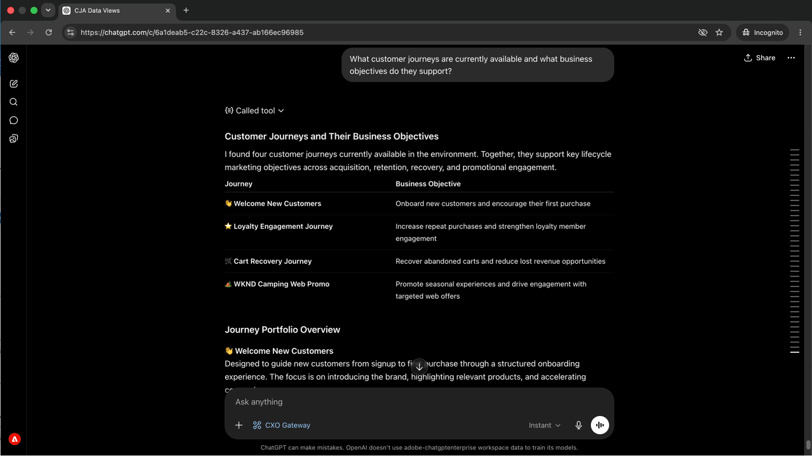
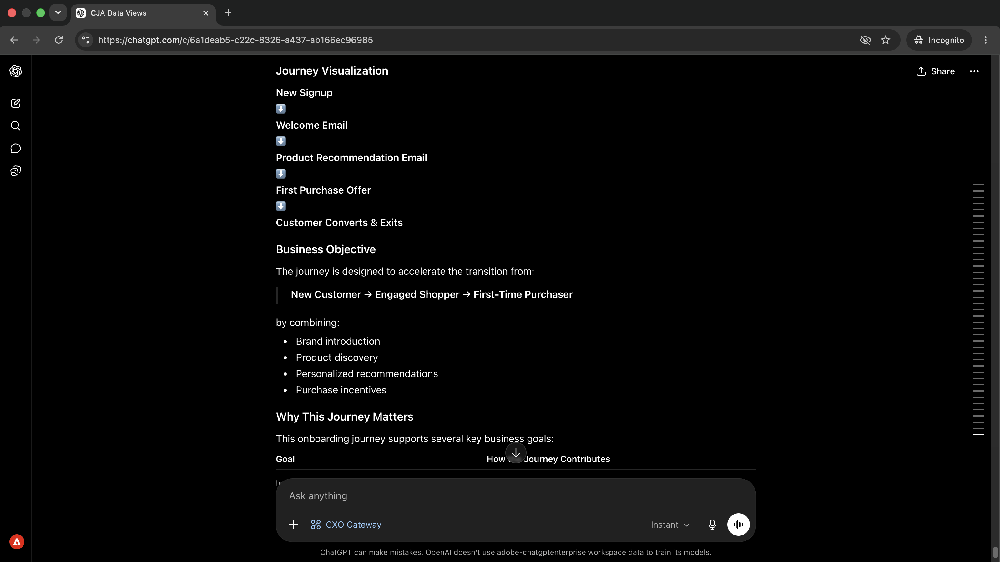
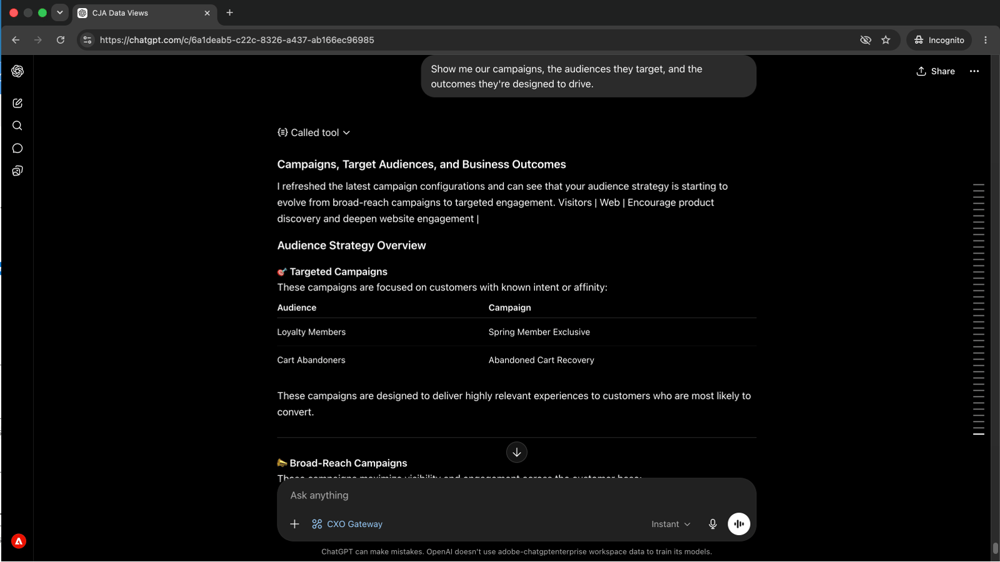
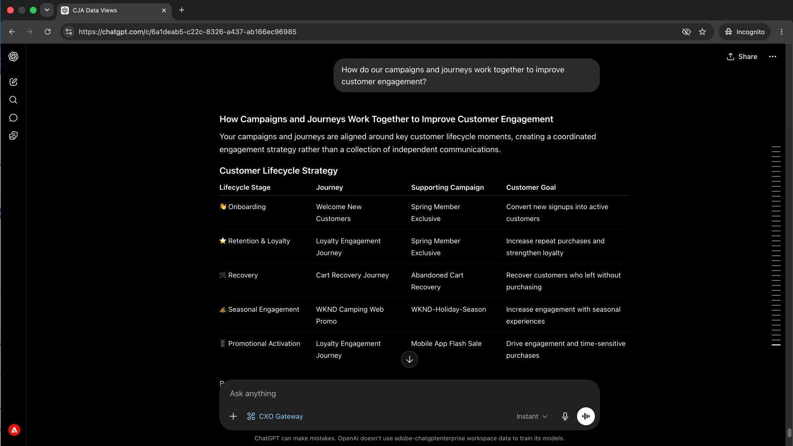
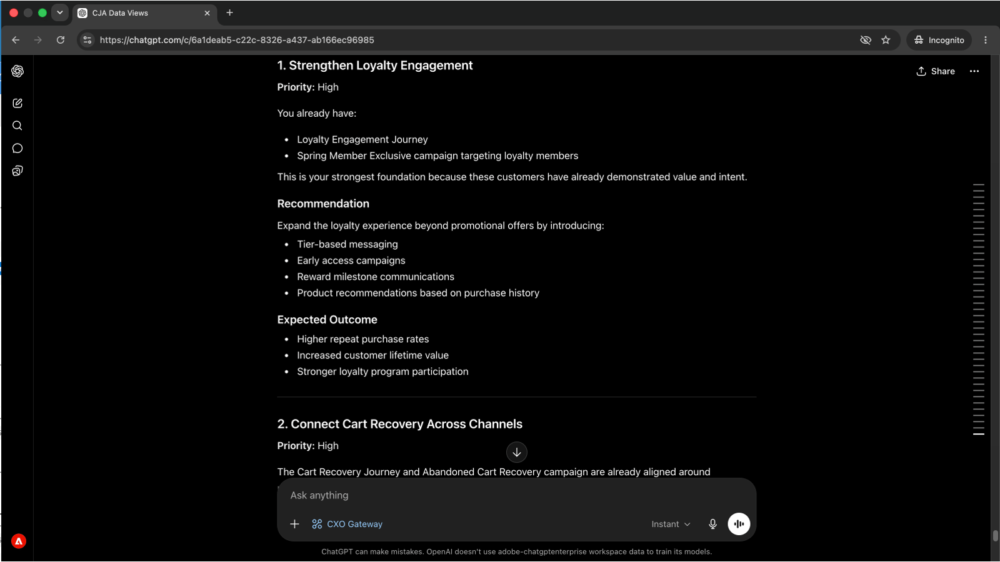

# Detecte los problemas de recorrido antes de que afecten a los clientes
<!-- last-modified: 2026-06-08 -->


Obtener una imagen clara de qué recorridos están activos, qué condiciones los impulsan y cómo se configuran las campañas normalmente significa abrir Adobe Journey Optimizer y navegar por su interfaz. Este tutorial muestra cómo obtener la misma visibilidad a través de un cliente de IA, utilizando CX Enterprise MCP para consultar el recorrido de AJO y los datos de campaña a través de preguntas en lenguaje sencillo.

| Detalles del escenario | |
| --- | --- |
| Aplicaciones empresariales de CX | [Adobe Journey Optimizer (AJO)](https://experienceleague.adobe.com/es/docs/journey-optimizer/using/ajo-home) |
| Herramientas agénticas | [MCP de CX Enterprise](../tools/mcp-servers.md#cx-enterprise-mcp-servers) |
| Público | Administradores de campañas, especialistas en marketing |
| Requisito previo | Cliente de IA compatible con MCP, acceso a AJO |

Cada paso muestra un mensaje representativo y un ejemplo de respuesta de IA. **Más cosas que puedes hacer** sección sigue para una exploración adicional en la misma sesión.


## Antes de empezar

>[!BEGINTABS]

>[!TAB Claude.ai]

Conecte el MCP de CX Enterprise como un conector personalizado para acceder a las herramientas de Adobe Journey Optimizer.

1. Vaya a **Configuración > Integraciones** en Claude.ai.
2. Seleccione **Agregar conector personalizado** e introduzca la dirección URL del servidor: `https://cx-enterprise.adobe.io/mcp`
3. Seleccione **Conectar** e inicie sesión con su Adobe ID.

Configuración completa: [Documentación de conectores personalizados Claude.ai](https://support.claude.com/en/articles/11175166-get-started-with-custom-connectors-using-remote-mcp)

>[!TAB ChatGPT]

Conecte el MCP de CX Enterprise mediante el modo de desarrollador de ChatGPT (se requiere plan profesional, avanzado, empresarial, empresarial o educativo).

1. Habilitar **Modo de desarrollador** en **Configuración de ChatGPT**.
2. Vaya a **Configuración > Integraciones** y seleccione **Agregar conector personalizado > Servidor MCP remoto**.
3. Escriba la dirección URL del servidor: `https://cx-enterprise.adobe.io/mcp`
4. Seleccione **Conectar** e inicie sesión con su Adobe ID.

Configuración completa: [Documentación de MCP de ChatGPT](https://developers.openai.com/api/docs/guides/tools-connectors-mcp)

>[!TAB Otros clientes de IA]

¿Utiliza Gemini, Microsoft Copilot, Cursor, Claude Code u otro entorno compatible con MCP? Conéctese a CX Enterprise MCP utilizando este punto de conexión:

```
https://cx-enterprise.adobe.io/mcp
```

Instrucciones de configuración completas para todos los clientes admitidos: [Conéctese a su cliente de IA](../tools/mcp-servers.md)

>[!ENDTABS]

>[!NOTE]
>
>Inicie sesión con su Adobe ID cuando se le solicite y seleccione la organización de IMS vinculada a su entorno de AJO. La elección de una organización incorrecta es la fuente más común de errores de autenticación.
>
>En la primera conexión, el cliente de IA puede pedirle que seleccione una organización de IMS o que especifique una zona protegida. Una vez establecido ese contexto, el servidor MCP lo utiliza para el resto de la sesión.
>
>Algunas herramientas le piden su aprobación antes de ejecutarse. Revise la solicitud y apruébela o rechace. No se realiza ninguna acción sin su confirmación.


## Paso 1: Descubra los recorridos activos y su propósito

Comience por pedir un inventario de los recorridos activos y los objetivos empresariales subyacentes. Esto le proporciona una imagen completa antes de sumergirse en un recorrido específico.

```
What customer journeys are currently available and what business objectives do they support?
```

+++Ver una respuesta de ejemplo



+++


## Paso 2: Revisar los pasos y la experiencia del cliente de un recorrido

Con la lista de recorridos a la vista, pida a su cliente de IA que siga los pasos de un recorrido específico y explique lo que el cliente experimenta en cada fase.

```
Walk me through the [journey name] journey and explain the customer experience.
```

+++Ver una respuesta de ejemplo



+++


>[!NOTE]
>
>Reemplace `[journey name]` con el nombre de un recorrido de sus resultados del paso 1.


## Paso 3: Revisar campañas, audiencias y objetivos

Cambio de recorridos a campañas. Pida un resumen de las campañas activas, a quién se dirigen y qué resultados están diseñados para impulsar.

```
Show me our campaigns, the audiences they target, and the outcomes they're designed to drive.
```

+++Ver una respuesta de ejemplo



+++


## Paso 4: Comprender cómo se conectan las campañas y los recorridos

Pida a su cliente de IA que conecte los puntos entre campañas y recorridos, y que le explique cómo trabajan juntos para lograr objetivos de participación compartidos.

```
How do our campaigns and journeys work together to improve customer engagement?
```

+++Ver una respuesta de ejemplo



+++


## Paso 5: Obtener recomendaciones con prioridad

Pida recomendaciones priorizadas sobre en qué centrarse a continuación, enmarcadas desde la perspectiva de un administrador de marketing del ciclo vital. Esto muestra las brechas y oportunidades más impactantes de todo lo analizado en la sesión.

```
If you were our lifecycle marketing manager, what would you prioritize next and why?
```

+++Ver una respuesta de ejemplo



+++


>[!NOTE]
>
>El servidor MCP de AJO muestra la información de recorridos y campañas, pero no puede modificar recorridos, campañas o contenido. Para implementar recomendaciones, vaya a la aplicación de AJO directamente o conecte AEM Content MCP Server para realizar cambios de contenido en la misma sesión.


## Lo que ha conseguido

Ha conectado un cliente de IA a Adobe Journey Optimizer y ha creado una imagen completa de su catálogo de recorridos y campañas con cinco mensajes. Ha inventariado los recorridos activos y sus objetivos comerciales, ha revisado paso a paso la experiencia del cliente para un recorrido específico, ha asignado campañas activas a sus audiencias y resultados previstos, ha comprendido cómo funcionan juntas las campañas y los recorridos, y ha recibido recomendaciones priorizadas sobre dónde centrarse a continuación. Esto proporciona a los administradores de campañas y marketing del ciclo vital visibilidad estratégica sin abrir la interfaz de AJO.


## Más cosas que puede lograr

CX Enterprise MCP puede mostrar una amplia gama de detalles de recorridos y campañas de AJO. Expanda un escenario de abajo para ver las indicaciones que puede probar en la misma sesión.

+++Sepa lo que está activo antes de hacer un cambio

Realizar cambios en un recorrido sin saber qué más se está ejecutando es arriesgado. Estos indicadores le proporcionan un inventario actual de lo que está activo, lo que se ha modificado recientemente y cómo se configuran las campañas.

**Indicadores**

```
Show me all journeys modified in the last 7 days.
```

```
Show me all journeys that use SMS as a channel.
```

```
Which campaigns are scheduled to end this week?
```

```
What loyalty challenges are currently active?
```

+++

+++Explorar los detalles de un recorrido específico

Cuando necesita revisar, aprobar o entregar un recorrido, tener la lógica completa delante sin abrir AJO le ahorra tiempo. Estos indicadores muestran condiciones, programaciones y reglas de segmentos bajo demanda.

**Indicadores**

```
What is the entry condition for the [journey name] journey?
```

```
What are the exit conditions and timeout rules for the [journey name] journey?
```

```
What messages and wait conditions are in the [journey name] journey?
```

```
Which segment does the [journey name] journey target?
```

+++

+++Profundizar en los detalles de una campaña específica

Cuando necesita revisar la configuración completa de una campaña antes de aprobarla, entregarla o realizar cambios, estos mensajes muestran reglas de audiencia, configuración de canal y detalles de programación sin abrir AJO.

**Indicadores**

```
Walk me through the full configuration of the [campaign name] campaign.
```

```
What audience does the [campaign name] campaign target and how large is that segment?
```

```
What frequency cap and send schedule apply to the [campaign name] campaign?
```

```
Are any campaigns targeting overlapping audiences?
```

```
What channel configurations are set up in our AJO environment?
```

+++


## Más información

| Recurso | Qué va a encontrar |
| --- | --- |
| [Servidor MCP de AJO en el registro de IA](https://developer.adobe.com/ai-registry/#/mcp/ajo-mcp-server) | Disponibilidad y herramientas del servidor AJO MCP |
| [Documentación de AJO](https://experienceleague.adobe.com/es/docs/journey-optimizer/using/ajo-home) | Documentación completa de la aplicación de AJO |
| [API de AJO](https://developer.adobe.com/journey-optimizer-apis/) | Referencia de la API de AJO para integraciones personalizadas |
| [Tutoriales de AJO](https://experienceleague.adobe.com/es/docs/journey-optimizer-learn/tutorials/overview) | Tutoriales de vídeo y rutas de aprendizaje |
