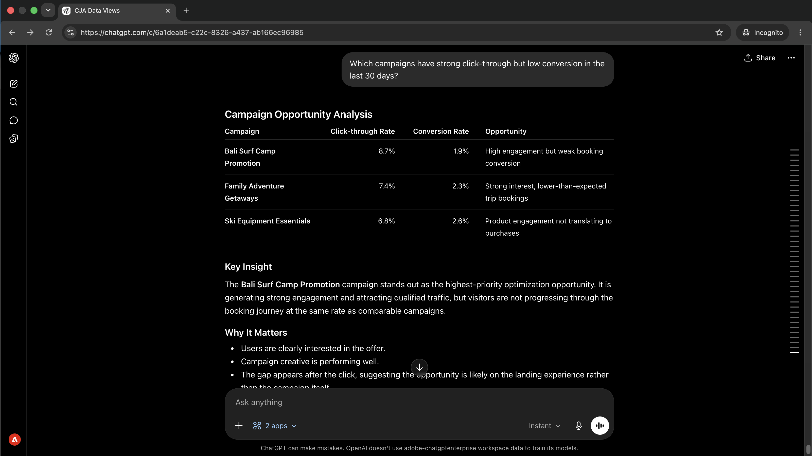
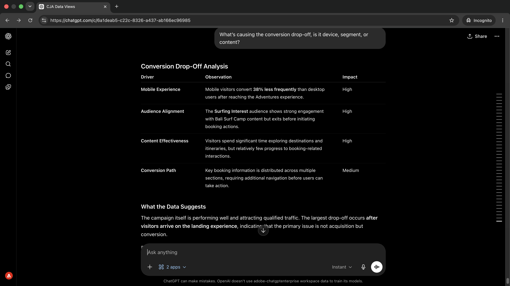
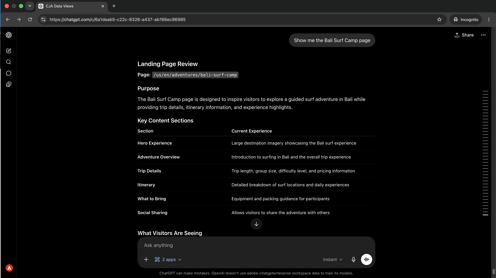
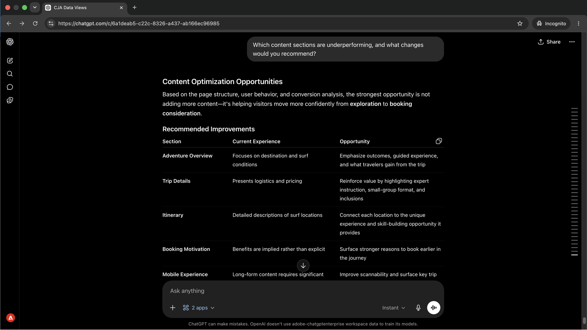
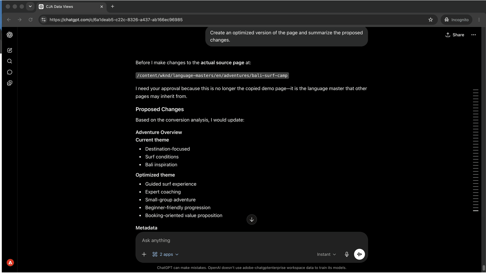

# Optimización del contenido en función de los datos de rendimiento
<!-- last-modified: 2026-06-08 -->


Normalmente, cerrar el bucle entre los datos de rendimiento de la campaña y las actualizaciones de contenido significa cambiar entre la herramienta de análisis y la CMS. Este tutorial muestra cómo conectar Customer Journey Analytics y AEM en la misma sesión de IA: superponga campañas con brechas de conversión, diagnostique lo que las impulsa, inspeccione el contenido, obtenga recomendaciones segmentadas y aplique cambios sin abandonar la conversación.

| | |
| --- | --- |
| Aplicaciones empresariales de CX | Customer Journey Analytics, Adobe Experience Manager as a Cloud Service |
| Herramientas agénticas | CX Enterprise MCP Gateway, AEM Content MCP Server |
| Público | Administradores de campañas, estrategas de contenido, operaciones de marketing |
| Requisito previo | cliente de IA compatible con MCP, acceso a CJA, acceso a AEM as a Cloud Service |

Cada paso muestra un mensaje representativo y un ejemplo de respuesta de IA. **Más cosas que puedes hacer** sección sigue para una exploración adicional en la misma sesión.


## Antes de empezar

>[!BEGINTABS]

>[!TAB Claude.ai]

Conecte ambos servidores MCP como conectores personalizados. Añada cada uno por separado.

1. Vaya a **Configuración > Integraciones** en Claude.ai.
2. Seleccione **Agregar conector personalizado**, escriba una dirección URL de servidor y seleccione **Conectar**.
3. Inicie sesión con su Adobe ID y, a continuación, repita para el segundo servidor.

| Servidor | Punto de conexión |
| --- | --- |
| CX Enterprise MCP Gateway | `https://cx-enterprise.adobe.io/mcp` |
| Servidor MCP de contenido de AEM | `https://mcp.adobeaemcloud.com/adobe/mcp/content` |

Configuración completa: [Documentación de conectores personalizados Claude.ai](https://support.claude.com/en/articles/11175166-get-started-with-custom-connectors-using-remote-mcp)

>[!TAB ChatGPT]

Conecte ambos servidores MCP mediante el modo de desarrollador de ChatGPT (se requiere plan profesional, avanzado, empresarial, o educativo). Agregue cada servidor por separado.

1. Habilitar **Modo de desarrollador** en **Configuración de ChatGPT**.
2. Vaya a **Configuración > Integraciones** y seleccione **Agregar conector personalizado > Servidor MCP remoto**.
3. Escribe una URL de servidor, selecciona **Conectar** e inicia sesión con tu Adobe ID.
4. Repita el proceso para el segundo servidor.

| Servidor | Punto de conexión |
| --- | --- |
| CX Enterprise MCP Gateway | `https://cx-enterprise.adobe.io/mcp` |
| Servidor MCP de contenido de AEM | `https://mcp.adobeaemcloud.com/adobe/mcp/content` |

Configuración completa: [Documentación de MCP de ChatGPT](https://developers.openai.com/api/docs/guides/tools-connectors-mcp)

>[!TAB Otros clientes de IA]

¿Utiliza Gemini, Microsoft Copilot, Cursor, Claude Code u otro entorno compatible con MCP? Conéctese a ambos servidores MCP mediante estos extremos:

| Servidor | Punto de conexión |
| --- | --- |
| CX Enterprise MCP Gateway | `https://cx-enterprise.adobe.io/mcp` |
| Servidor MCP de contenido de AEM | `https://mcp.adobeaemcloud.com/adobe/mcp/content` |

Instrucciones de configuración completas para todos los clientes admitidos: [Conéctese a su cliente de IA](../tools/mcp-servers.md)

>[!ENDTABS]

>[!NOTE]
>
>Inicie sesión con su Adobe ID cuando se le solicite y seleccione la organización de IMS vinculada a sus entornos de CJA y AEM. La elección de una organización incorrecta es la fuente más común de errores de autenticación.
>
>En la primera conexión, el cliente de IA puede pedirle que seleccione una organización de IMS o que especifique una zona protegida. Una vez establecido ese contexto, el servidor MCP lo utiliza para el resto de la sesión.
>
>Algunas herramientas le piden su aprobación antes de ejecutarse. Revise la solicitud y apruébela o rechace: no se realiza ninguna acción sin su confirmación.


## Paso 1: Encuentre campañas con un intervalo de conversión

Utilice CJA para que aparezcan campañas en las que la proporción de clics sea alta pero la tasa de conversión sea baja. Este patrón (de alta intención, baja finalización) suele señalar a un problema de contenido o experiencia en la página de aterrizaje.

```
Which campaigns have strong click-through but low conversion in the last 30 days?
```

+++Ver una respuesta de ejemplo



+++


## Paso 2: Diagnóstico de la causa raíz

Realice un seguimiento para comprender qué es lo que impulsa la brecha. Pregunte si la lista desplegable se concentra en un tipo de dispositivo, segmento de audiencia o interacción de contenido específicos.

```
What's causing the conversion drop-off, is it device, segment, or content?
```

+++Ver una respuesta de ejemplo



+++


## Paso 3: Revisar el contenido en AEM

Con la campaña de bajo rendimiento identificada, extraiga la página de aterrizaje de AEM en la misma sesión. Ver lo que dice la página actualmente es el punto de partida para comprender qué cambiar.

```
Show me the Bali Surf Camp page.
```

+++Ver una respuesta de ejemplo



+++


## Paso 4: Obtener recomendaciones específicas

Solicite a su cliente de IA que conecte los datos mostrados con lo que figura en la página. La inteligencia artificial justifica en ambas fuentes la identificación de qué secciones de contenido son las causantes probables de la entrega y qué cambiar.

```
Which content sections are underperforming, and what changes would you recommend?
```

+++Ver una respuesta de ejemplo



+++


## Paso 5: Aplicar y revisar los cambios

Solicite a su cliente de IA que cree una versión optimizada de la página en función de las recomendaciones y que resuma qué ha cambiado y por qué.

```
Create an optimized version of the Bali Surf Camp page and summarize the proposed changes.
```

+++Ver una respuesta de ejemplo



+++


>[!CAUTION]
>
>Revise el resumen completo de los cambios propuestos antes de confirmarlo. El servidor MCP de contenido de AEM escribirá cambios en el entorno de AEM. Las páginas permanecen en su estado publicado hasta que se vuelve a publicar explícitamente.


## Lo que ha conseguido

Ha conectado Customer Journey Analytics y AEM en una sola sesión de IA y ha pasado de los datos de la campaña a los cambios de contenido implementados sin cambiar de herramienta. Ha identificado campañas con brechas de conversión, ha diagnosticado la causa raíz, ha inspeccionado la página de aterrizaje, ha recibido recomendaciones segmentadas basadas en datos y contenido y ha aplicado los cambios en la misma conversación. Esto acorta el bucle de comentarios entre Analytics insight y el contenido publicado, y se adapta a cualquier número de páginas de bajo rendimiento en la misma sesión.


## Más cosas que puede lograr

Con CJA y AEM conectados en la misma sesión, puede cubrir todo el ciclo, desde la identificación de problemas hasta las correcciones de envío. Expanda un escenario de abajo para ver las indicaciones que puede probar.

+++Buscar el contenido que impide el rendimiento

El alto tráfico con baja participación indica un problema de contenido, no de tráfico. Estas indicaciones le ayudan a mostrar páginas y patrones específicos que requieren atención antes de que un plazo de campaña obligue al problema.

**Indicadores**

```
Which campaigns have the highest traffic but lowest conversion rate this quarter?
```

```
Which pages have a high bounce rate but also high traffic?
```

```
Compare engagement rates for landing pages across email and paid social campaigns.
```

```
Find AEM pages linked from active campaigns that haven't been updated in over 60 days.
```

+++

+++Corrija lo que los datos le indican que corrija

Una vez que sepa qué es el bajo rendimiento, realice cambios dirigidos basados en lo que revelaron los datos de rendimiento. Estas indicaciones permiten actualizar secciones específicas en función del diagnóstico.

**Indicadores**

```
Update the CTA on the [page name] page to better match the campaign audience.
```

```
Rewrite the hero headline on the [page name] page to address the mobile drop-off.
```

```
Add a trust signal to the [page name] page above the conversion form.
```

```
Which pages updated in this session still need to be published?
```

+++

+++Mejoras de envíos antes de la próxima campaña

Los cambios realizados a mitad de la sesión se pueden acumular rápidamente. Estas indicaciones le ayudan a revisar lo que está listo, agrupar las actualizaciones para su revisión y promocionar claramente antes de que una campaña se ponga en marcha.

**Indicadores**

```
Show me all pages updated in this session that are still unpublished.
```

```
Create a launch with all changes from this session for review before publishing.
```

```
Give me a summary of all changes made in this session.
```

```
Publish all confirmed changes and share the updated URLs.
```

+++


## Más información

| Recurso | Qué va a encontrar |
| --- | --- |
| [Documentación del servidor MCP de CJA](https://developer.adobe.com/analytics-mcp/docs/cja/) | Configuración y referencia de la herramienta del MCP de CJA |
| [Documentación de AEM Content MCP Server](https://experienceleague.adobe.com/en/docs/experience-manager-cloud-service/content/ai-in-aem/using-mcp-with-aem-as-a-cloud-service) | Guía de uso y configuración del MCP de contenido de AEM |
| [Servidor MCP de CJA en el registro de IA](https://developer.adobe.com/ai-registry/#/mcp/cja-mcp) | Disponibilidad y herramientas del servidor CJA MCP |
| [Servidor MCP de contenido de AEM en el registro de IA](https://developer.adobe.com/ai-registry/#/mcp/aem-content-mcp) | Disponibilidad y herramientas del servidor MCP de contenido de AEM |
| [Servidores MCP](../tools/mcp-servers.md) | Conectar un cliente de IA a servidores MCP de Adobe |
