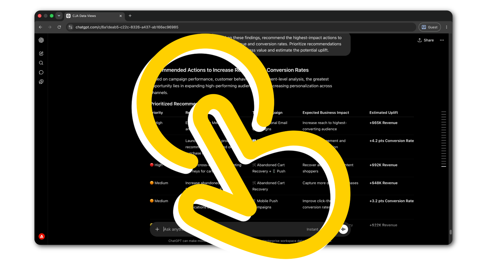

# Herramientas agénticas en acción

<!-- last-modified: 2026-06-08 -->

Tutoriales paso a paso sobre los flujos de trabajo empresariales reales de Adobe CX. Cada tutorial comienza donde termina la configuración, con las herramientas conectadas y un flujo de trabajo real por completar.

<!--
CARDS

* analyze-campaign-performance.md
  {title = Analyze campaign performance}
  {description = Surface Customer Journey Analytics comparisons and conversion trends through plain-language questions. Uses CX Enterprise MCP.}
  {cta = Start walkthrough}

* query-audiences.md
  {title = Query audiences}
  {description = Check Real-Time CDP audience activation status and destination health without navigating the platform UI. Uses CX Enterprise MCP.}
  {cta = Start walkthrough}

* manage-ajo-journeys.md
  {title = Review AJO journeys}
  {description = Get full visibility into active AJO journeys and campaign configuration without opening AJO. Uses CX Enterprise MCP.}
  {cta = Start walkthrough}

* manage-aem-content.md
  {title = Manage AEM content with AI}
  {description = Discover, update, and publish pages and content fragments using natural language. Uses the AEM Content MCP Server.}
  {cta = Start walkthrough}

* optimize-content-with-performance-data.md
  {title = Optimize content based on performance data}
  {description = Move from analytics insight to published update in one session, without switching tools. Uses CX Enterprise MCP and AEM Content MCP Server.}
  {cta = Start walkthrough}

* cross-channel-campaign-review.md
  {title = Run a cross-channel campaign review}
  {description = Review AJO journey status, Real-Time CDP audience activation, and CJA performance data in one AI session. Uses CX Enterprise MCP.}
  {cta = Start walkthrough}

* aem-cloud-manager-mcp.md
  {title = Manage AEM environments with Cloud Manager}
  {description = Check environment health, review pipeline runs, and manage deployments from your AI client. Uses the AEM Cloud Manager MCP Server.}
  {cta = Start walkthrough}
  {image = https://video.tv.adobe.com/v/3480340?format=jpeg}
-->
<!-- START CARDS HTML - DO NOT MODIFY BY HAND -->

    

        

            

                <figure class="image x-is-16by9">
                    
                </figure>
            

            

                

                    

                        <a href="analyze-campaign-performance.md" target="_blank" rel="referrer" title="Analizar el rendimiento de la campaña">Analizar el rendimiento de la campaña</a>
                    

                    
Comparaciones y tendencias de conversión de Surface Customer Journey Analytics mediante preguntas en lenguaje sencillo. Utiliza CX Enterprise MCP.

                

                <a href="analyze-campaign-performance.md" target="_blank" rel="referrer" class="spectrum-Button spectrum-Button--outline spectrum-Button--primary spectrum-Button--sizeM" style="align-self: flex-start; margin-top: 1rem;">
                    Iniciar tutorial
                </a>
            

        

    

    

        

            

                <figure class="image x-is-16by9">
                    
                </figure>
            

            

                

                    

                        <a href="query-audiences.md" target="_blank" rel="referrer" title="Consultar audiencias">Consultar audiencias</a>
                    

                    
Compruebe el estado de activación de la audiencia de Real-Time CDP y el estado de destino sin navegar por la IU de Platform. Utiliza CX Enterprise MCP.

                

                <a href="query-audiences.md" target="_blank" rel="referrer" class="spectrum-Button spectrum-Button--outline spectrum-Button--primary spectrum-Button--sizeM" style="align-self: flex-start; margin-top: 1rem;">
                    Iniciar tutorial
                </a>
            

        

    

    

        

            

                <figure class="image x-is-16by9">
                    
                </figure>
            

            

                

                    

                        <a href="manage-ajo-journeys.md" target="_blank" rel="referrer" title="Revisar AJO recorrido">Revisar recorridos de AJO</a>
                    

                    
Obtenga visibilidad completa de los recorridos activos de AJO y la configuración de campañas sin abrir AJO. Utiliza CX Enterprise MCP.

                

                <a href="manage-ajo-journeys.md" target="_blank" rel="referrer" class="spectrum-Button spectrum-Button--outline spectrum-Button--primary spectrum-Button--sizeM" style="align-self: flex-start; margin-top: 1rem;">
                    Iniciar tutorial
                </a>
            

        

    

    

        

            

                <figure class="image x-is-16by9">
                    
                </figure>
            

            

                

                    

                        <a href="manage-aem-content.md" target="_blank" rel="referrer" title="Administración de contenido de AEM con IA">Administrar contenido de AEM con IA</a>
                    

                    
Descubra, actualice y publique páginas y fragmentos de contenido con lenguaje natural. Utiliza AEM Content MCP Server.

                

                <a href="manage-aem-content.md" target="_blank" rel="referrer" class="spectrum-Button spectrum-Button--outline spectrum-Button--primary spectrum-Button--sizeM" style="align-self: flex-start; margin-top: 1rem;">
                    Iniciar tutorial
                </a>
            

        

    

    

        

            

                <figure class="image x-is-16by9">
                    
                </figure>
            

            

                

                    

                        <a href="optimize-content-with-performance-data.md" target="_blank" rel="referrer" title="Optimización del contenido en función de los datos de rendimiento">Optimizar contenido basado en datos de rendimiento</a>
                    

                    
Pásese de Analytics insight a la actualización publicada en una sesión, sin cambiar de herramienta. Utiliza CX Enterprise MCP y AEM Content MCP Server.

                

                <a href="optimize-content-with-performance-data.md" target="_blank" rel="referrer" class="spectrum-Button spectrum-Button--outline spectrum-Button--primary spectrum-Button--sizeM" style="align-self: flex-start; margin-top: 1rem;">
                    Iniciar tutorial
                </a>
            

        

    

    

        

            

                <figure class="image x-is-16by9">
                    
                </figure>
            

            

                

                    

                        <a href="cross-channel-campaign-review.md" target="_blank" rel="referrer" title="Ejecutar una revisión de campaña en canales múltiples">Ejecutar una revisión de campaña en canales múltiples</a>
                    

                    
Revise el estado del recorrido de AJO, la activación de audiencias de Real-Time CDP y los datos de rendimiento de CJA en una sesión de IA. Utiliza CX Enterprise MCP.

                

                <a href="cross-channel-campaign-review.md" target="_blank" rel="referrer" class="spectrum-Button spectrum-Button--outline spectrum-Button--primary spectrum-Button--sizeM" style="align-self: flex-start; margin-top: 1rem;">
                    Iniciar tutorial
                </a>
            

        

    

    

        

            

                <figure class="image x-is-16by9">
                    
                </figure>
            

            

                

                    

                        <a href="aem-cloud-manager-mcp.md" target="_blank" rel="referrer" title="Administración de entornos de AEM con Cloud Manager">Administrar entornos de AEM con Cloud Manager</a>
                    

                    
Compruebe el estado del entorno, revise las ejecuciones de la canalización y administre las implementaciones desde su cliente de IA. Utiliza AEM Cloud Manager MCP Server.

                

                <a href="aem-cloud-manager-mcp.md" target="_blank" rel="referrer" class="spectrum-Button spectrum-Button--outline spectrum-Button--primary spectrum-Button--sizeM" style="align-self: flex-start; margin-top: 1rem;">
                    Iniciar tutorial
                </a>
            

        

    

<!-- END CARDS HTML - DO NOT MODIFY BY HAND -->

## Preguntas frecuentes

+++¿Cómo consulto los datos de Adobe de un cliente de IA?

Utilice un servidor MCP. Conecte su cliente de IA al punto final del servidor de Adobe MCP correspondiente y haga preguntas en lenguaje natural. El servidor traduce la solicitud a llamadas a la API de Adobe y devuelve resultados estructurados.

Consulte [Servidores MCP](../tools/mcp-servers.md) para comenzar.

+++

+++¿Cómo se crea un flujo de trabajo que conecta varias aplicaciones de Adobe?

Conéctese a varios servidores MCP en una sola sesión de IA o utilice las API de Adobe para la orquestación personalizada de varias aplicaciones.

Ver [API para generadores](../tools/apis.md) y [servidores MCP](../tools/mcp-servers.md).

+++

+++¿Cómo hago para que un agente siga las prácticas recomendadas de Adobe?

Use Aptitudes de agente. Las habilidades codifican la experiencia del dominio de Adobe para que los agentes completen las tareas de forma coherente.

Ver [Aptitudes de agente](../tools/agent-skills.md).

+++

+++¿Qué clientes de IA trabajan con servidores MCP de Adobe?

Cualquier cliente compatible con MCP. Claude Code, Claude.ai, Cursor, ChatGPT y Google Gemini son compatibles con MCP. Consulte [Servidores MCP](../tools/mcp-servers.md) para ver una comparación de clientes y vínculos de configuración completos.

+++
