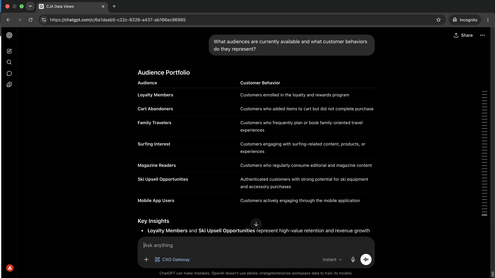
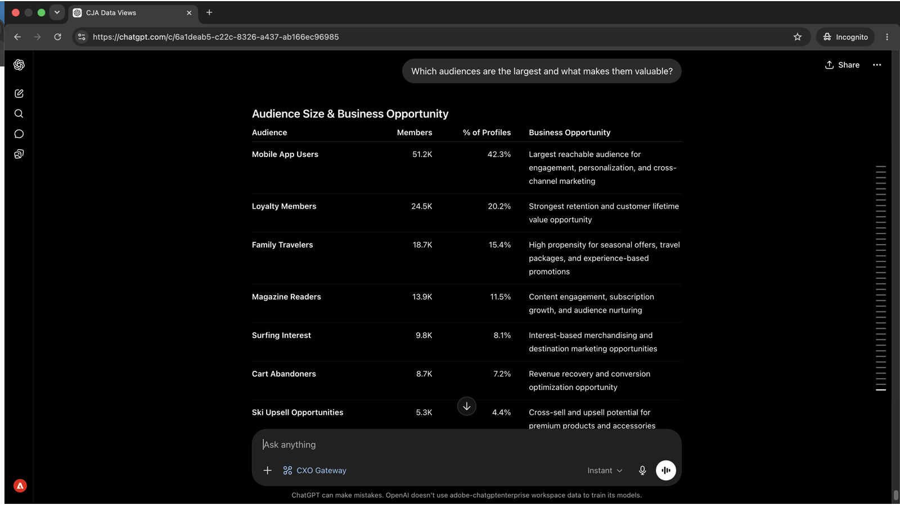
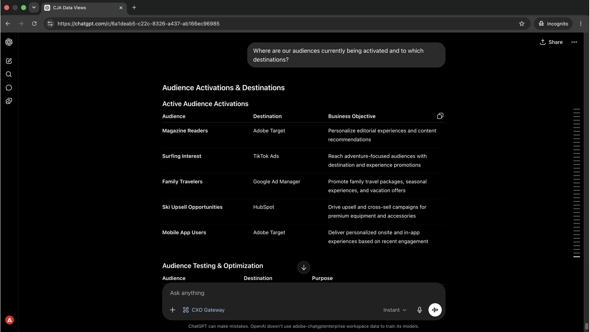
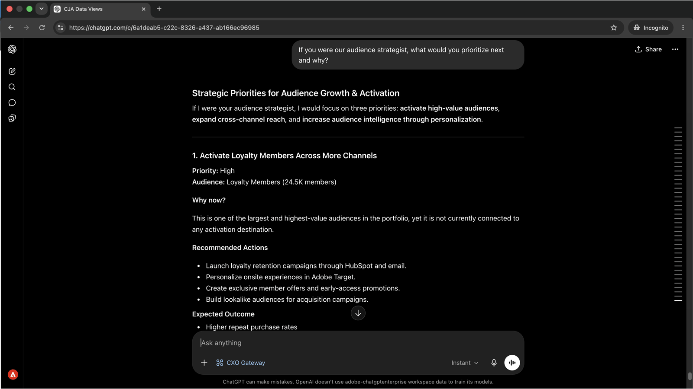

# Comprenda sus audiencias y dónde se activan

<!-- last-modified: 2026-06-04 -->


Saber qué audiencias están activas, a dónde fluyen y si los destinos están en buen estado es fundamental antes de que se inicie una campaña o cuando el rendimiento de una es inferior al esperado. Este tutorial muestra cómo obtener una imagen completa de la activación mediante un cliente de IA, utilizando el MCP de CX Enterprise para mostrar el estado de la audiencia y el estado del destino en segundos, sin necesidad de abrir Real-Time CDP.

| Detalles del escenario | |
| --- | --- |
| Aplicaciones empresariales de CX | [Real-Time Customer Data Platform (Real-Time CDP)](https://experienceleague.adobe.com/es/docs/experience-platform/rtcdp/home) |
| Herramientas agénticas | [MCP de CX Enterprise](../tools/mcp-servers.md#cx-enterprise-mcp-servers) |
| Público | Especialistas en marketing, analistas y operadores |
| Requisito previo | Cliente de IA compatible con MCP, acceso a Real-Time CDP |

Cada paso muestra un mensaje representativo y un ejemplo de respuesta de IA. **Más cosas que puedes hacer** sección sigue para una exploración adicional en la misma sesión.

## Antes de empezar

>[!BEGINTABS]

>[!TAB Claude.ai]

Conecte el MCP de CX Enterprise como un conector personalizado para acceder a las herramientas de Real-Time CDP.

1. Vaya a **Configuración > Integraciones** en Claude.ai.
2. Seleccione **Agregar conector personalizado** e introduzca la dirección URL del servidor: `https://cx-enterprise.adobe.io/mcp`
3. Seleccione **Conectar** e inicie sesión con su Adobe ID.

Configuración completa: [Documentación de conectores personalizados Claude.ai](https://support.claude.com/en/articles/11175166-get-started-with-custom-connectors-using-remote-mcp)

>[!TAB ChatGPT]

Conecte el MCP de CX Enterprise mediante el modo de desarrollador de ChatGPT (se requiere plan profesional, avanzado, empresarial, empresarial o educativo).

1. Habilitar **Modo de desarrollador** en **Configuración de ChatGPT**.
2. Vaya a **Configuración > Integraciones** y seleccione **Agregar conector personalizado > Servidor MCP remoto**.
3. Escriba la dirección URL del servidor: `https://cx-enterprise.adobe.io/mcp`
4. Seleccione **Conectar** e inicie sesión con su Adobe ID.

Configuración completa: [Documentación de MCP de ChatGPT](https://developers.openai.com/api/docs/guides/tools-connectors-mcp)

>[!TAB Otros clientes de IA]

¿Utiliza Gemini, Microsoft Copilot, Cursor, Claude Code u otro entorno compatible con MCP? Conéctese a CX Enterprise MCP utilizando este punto de conexión:

```
https://cx-enterprise.adobe.io/mcp
```

Instrucciones de configuración completas para todos los clientes admitidos: [Conéctese a su cliente de IA](../tools/mcp-servers.md)

>[!ENDTABS]

>[!NOTE]
>
>Inicie sesión con su Adobe ID cuando se le solicite y seleccione la organización de IMS vinculada a su instancia de Real-Time CDP. La elección de una organización incorrecta es la fuente más común de errores de autenticación.

## Paso 1: Descubra sus audiencias y lo que representan

Comience por solicitar un inventario de las audiencias disponibles y los comportamientos de los clientes que capturan. Esto le proporciona el panorama completo antes de profundizar en cualquier segmento específico.

```
What audiences are currently available and what customer behaviors do they represent?
```

+++Ver una respuesta de ejemplo



+++


## Paso 2: Identificar los segmentos más valiosos

Con el panorama de la audiencia a la vista, pregunte qué segmentos son más grandes y qué los hace estratégicamente valiosos.

```
Which audiences are the largest and what makes them valuable?
```

+++Ver una respuesta de ejemplo



+++


## Paso 3: Revisar la activación y los destinos

Pregunte a dónde fluyen actualmente las audiencias y a qué destinos están activadas.

```
Where are our audiences currently being activated and to which destinations?
```

+++Ver una respuesta de ejemplo



+++


## Paso 4: Obtener recomendaciones estratégicas

Las herramientas RTCDP de CX Enterprise MCP son de solo lectura, muestran el estado de activación, el estado de destino y los datos de flujo de datos, pero no modifican la configuración. Una vez identificado un problema, la corrección se produce en la aplicación.

```
If you were our audience strategist, what would you prioritize next and why?
```

+++Ver una respuesta de ejemplo



+++


>[!NOTE]
>
>Las herramientas de RTCDP de CX Enterprise MCP muestran los datos de activación y destino, pero no pueden modificar la configuración de destino, las definiciones de segmentos ni la configuración del flujo de datos. Los pasos de corrección se realizan en la aplicación de Real-Time CDP.

## Lo que ha conseguido

Ha conectado un cliente de IA a Real-Time CDP y ha creado una imagen estratégica de su catálogo de audiencias en cuatro mensajes. Ha asignado las audiencias disponibles a los comportamientos de los clientes que capturan, ha identificado los segmentos más grandes y valiosos, ha confirmado dónde fluye cada audiencia y a qué destinos, y ha recibido recomendaciones priorizadas sobre la siguiente activación. Esto reemplaza la navegación por varias pantallas de Real-Time CDP con una conversación directa y estratégica.

## Más cosas que puede lograr

Las herramientas Real-Time CDP de CX Enterprise MCP admiten una amplia gama de consultas de audiencia y activación. Expanda un escenario de abajo para ver las indicaciones que puede probar en la misma sesión.

+++Saber exactamente qué está pasando a dónde antes de que una campaña envíe

Los errores de activación son silenciosos. Las audiencias dejan de fluir sin previo aviso y las campañas se envían a listas obsoletas. Estas indicaciones le proporcionan una idea clara de qué segmentos llegan a qué destinos y cuándo lo hacen.

**Indicadores**

```
Which audiences are activated to Google Ads?
```

```
Show me the activation history for the [audience name] audience.
```

```
What is the last refresh time for the [audience name] audience?
```

+++

+++Detecte los problemas de activación antes de que afecten a una campaña

Un destino en el que se ha perdido una ejecución o un segmento sin destino activo significa que la campaña puede llegar a menos personas de las previstas. Estos indicadores muestran esos huecos de forma proactiva.

**Indicadores**

```
Are there any audiences with no active destinations?
```

```
Are any destination dataflows showing errors right now?
```

```
Which audiences have not been updated in the last 30 days?
```

+++

+++Auditoría y comprensión de su panorama de audiencias

Cuando el tamaño de la audiencia cambia o se crean nuevos segmentos, tener un inventario claro le ayuda a planificar y evitar activar la lista incorrecta. Estas indicaciones le proporcionan esa visibilidad bajo demanda.

**Indicadores**

```
How many profiles are in the [segment name] segment?
```

```
Show me all audiences created in the last 30 days.
```

```
Which audience has grown the most in the last 60 days?
```

```
How many total profiles are in my Real-Time CDP instance?
```

+++

+++Comprender la identidad y la calidad de datos

Las áreas de nombres de identidad y las políticas de combinación afectan directamente a los perfiles que se incluyen en una audiencia y a cómo se resuelven. Estos mensajes muestran detalles de configuración que pueden explicar tamaños de audiencia inesperados o solapamientos de perfiles.

**Indicadores**

```
What identity namespaces are configured and which are most commonly used?
```

```
What merge policies are defined and which audiences use each one?
```

```
Are there any audiences using a non-default merge policy that could cause profile overlap?
```

+++


## Más información

| Recurso | Qué va a encontrar |
| --- | --- |
| [Registro de Adobe AI](https://developer.adobe.com/ai-registry/?type=mcp){target="_blank"} | Conectores administrados y detalles del servidor para determinados servidores MCP de Adobe |
| [Documentación de Real-Time CDP](https://experienceleague.adobe.com/es/docs/experience-platform/rtcdp/home){target="_blank"} | Documentación completa de la aplicación de Real-Time CDP |
